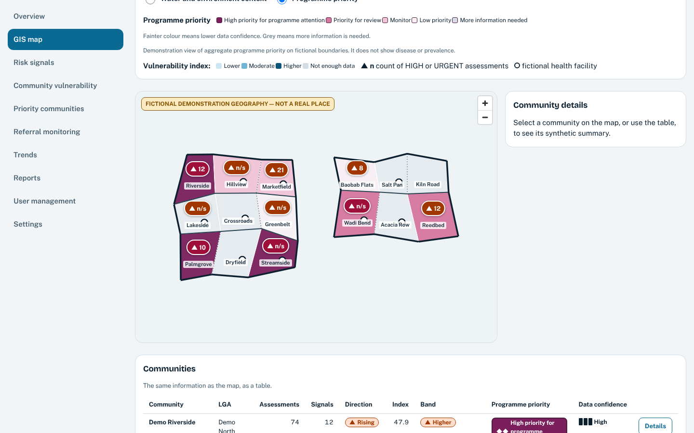
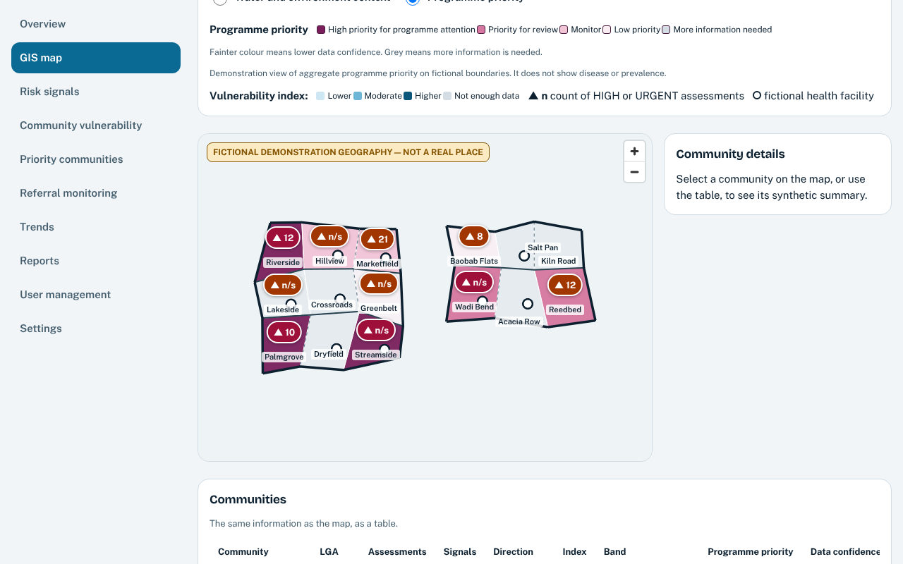
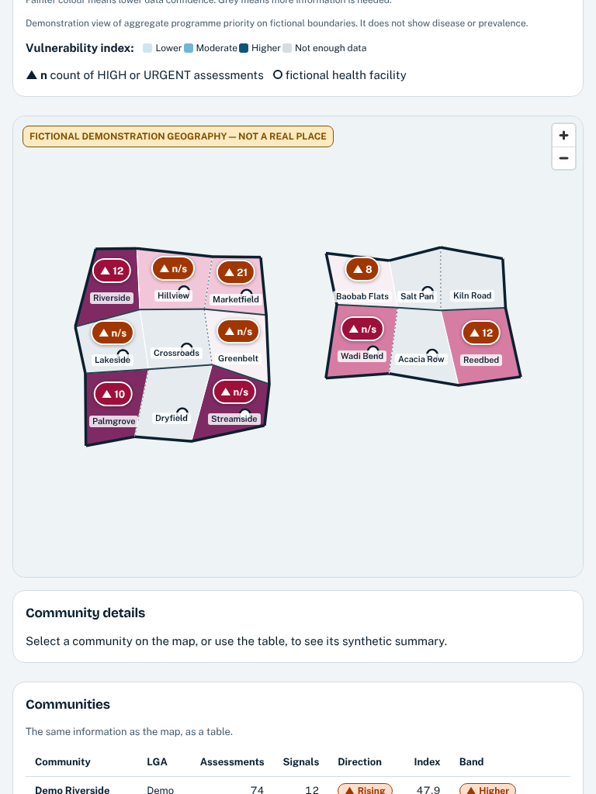
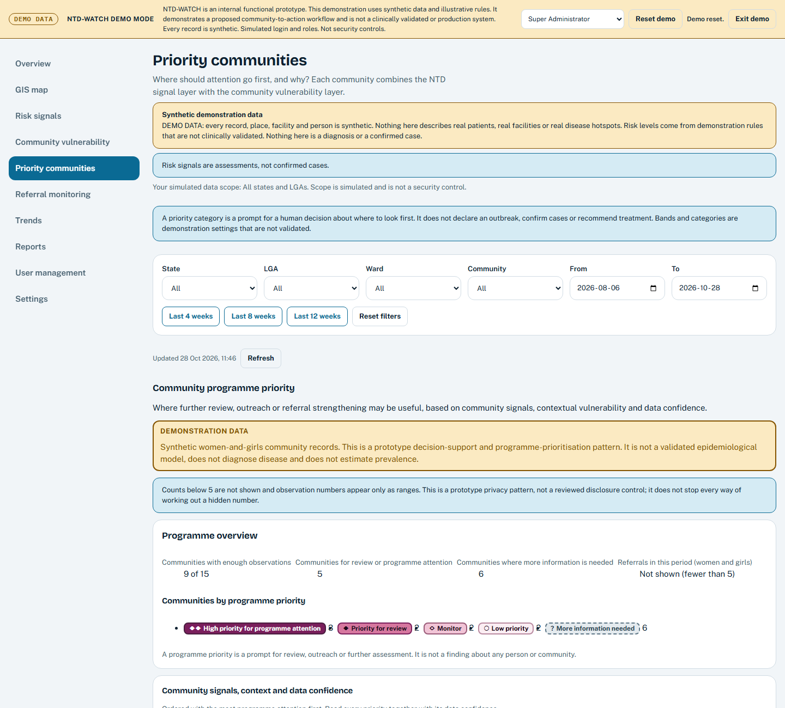
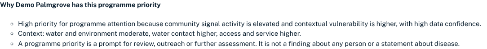
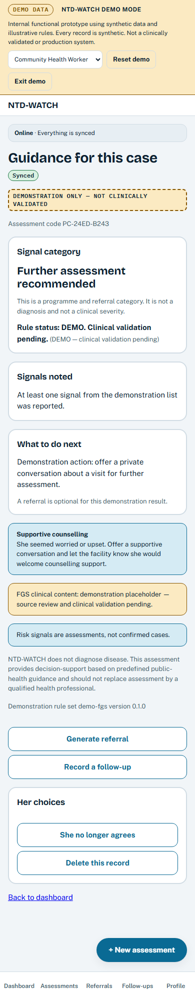
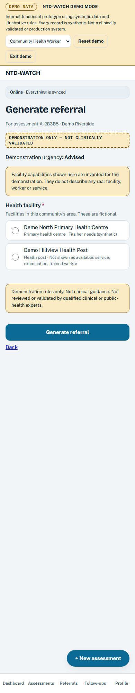

# NTD-WATCH: stakeholder demonstration pack

**Assembled 28 October 2026 from the current documentation and approved screenshots.**
**Synthetic data. Prototype. Mock API. Not clinically validated. Not a production system.**

Repository reference: this pack was assembled on 28 October 2026 against branch `feat/fgs-femtech-prep`, HEAD `3f91e8c`, plus uncommitted changes that existed then. Those changes, this pack and its supporting documents were later committed (commit `aaec91c`, 29 October 2026), and governance files, a logo and landing-page changes were added up to commit `700525b`, which is public on GitHub. The 31 October 2026 laptop verification run described in section 9 was made at `700525b`. The screenshots in this pack were captured on 28 October 2026, before Phase 4C, the logo and those landing-page changes, and have not been recaptured. The 28 October test figures remain as history for the earlier tree.

> **Read this first.** Everything shown is synthetic and runs in a browser against a mock server. NTD-WATCH does not diagnose, has not been clinically validated, has not been field tested or piloted, holds no real patient or programme data, and has no independent privacy or security review. The small-count rule described in this pack is a client-side display rule in the prototype, not a security control.
>
> **Test status.** Reported by the founder and not independently verified for this pack: `npx vitest run` passed 554 of 554 tests across 44 files, and the 6 dedicated reset-race and epoch tests passed 6 of 6. On 31 October 2026 the founder ran the full set of checks on the laptop at commit `700525b` with a script prepared for this pack and the output was read by the pack preparer: 554 of 554 unit tests in 44 files, 80 of 80 end-to-end tests, and typecheck, lint, format and build clean (section 9). The pack preparer did not run the tests on the laptop. An earlier intermittent, undiagnosed `DatabaseClosedError` (one unit-test run exited 1 on 28 October) has no established root cause, and the later reset/sync fix does not mean every possible reset/sync failure is eliminated. The unit-test suite is not described as proven stable (section 9).

## Contents

1. Executive overview
2. How it works: the four concepts
3. Approved screenshots
4. Two-minute demonstration script
5. Innovation rationale and proposed supervised-pilot pathway
6. Claims and evidence
7. Limitations, in plain language
8. Questions and answers
9. Evidence status and open engineering issue
10. Claims that must not be made

---

## 1. Executive overview

**The problem.** Community health workers can notice a pattern before any programme is able to act on it. The concern stays in a notebook or in scattered records, and the path from a community observation to a referral, a facility outcome and a follow-up is hard to see. For conditions that affect women and girls, privacy, safeguarding and access barriers (distance, cost, a preference for a woman clinician) widen the gap. This pack makes no statement about the size of that gap. Any statistic in an application has to be sourced separately.

**The proposal.** NTD-WATCH is a working prototype of a community-to-programme workflow:

1. A community health worker records a short, consented, non-diagnostic assessment (for the proposed use case, concerning women and girls and freshwater contact).
2. The app returns an explained signal category and supports a simulated, tracked referral pathway (prototype only; no real facility is involved).
3. Separately, a programme view shows community-level signals, contextual vulnerability and **data confidence**, so a programme can decide where review, outreach or referral strengthening might be useful.

**Status.** It runs entirely on synthetic data, with simulated sign-in and roles, against a mock API. Its value, if any, is a hypothesis to be tested through clinical review, privacy review and a supervised pilot. None of that has happened yet.

## 2. How it works: the four concepts

| Concept                  | What it means in the prototype                                                                                                                                                                                                                                                                                                                                                                         | What it is not                                                                                             |
| ------------------------ | ------------------------------------------------------------------------------------------------------------------------------------------------------------------------------------------------------------------------------------------------------------------------------------------------------------------------------------------------------------------------------------------------------ | ---------------------------------------------------------------------------------------------------------- |
| **Community assessment** | A short women-and-girls form. The prototype presents a consent choice before the assessment; the refusal and data-handling behaviour still require technical and privacy verification. Only an age range, water contact and a few signals are asked. No name, phone number, address or exact age; a case code stands in for her. The result is a signal category with reasons and "Rule status: DEMO". | Not a diagnosis, not a clinical severity, not a test. The rules are placeholders awaiting clinical review. |
| **Programme priority**   | For each community, a programme priority (four categories, plus "more information needed") built from community signal activity and contextual vulnerability (water and environment, water contact, access and service), always paired with **data confidence** and a plain-language explanation.                                                                                                      | Not severity, not prevalence, not a hotspot. Observations are not a representative sample.                 |
| **GIS view**             | A map of **fictional** boundaries coloured by programme priority. Fainter colour means lower data confidence; grey means more information is needed. Triangle badges show a count of HIGH or URGENT assessments; a count of 1 to 4 is shown as "n/s" (not shown, not zero). A table repeats the same figures.                                                                                          | Not a real place, no base map, no household locations, not disease distribution.                           |
| **Referral**             | A simulated referral from the assessment to a fictional facility, filtered by invented facility capabilities (service, trained worker, female clinician, examination, referral capacity). A simulated, tracked pathway with facility stage, outcome and follow-up follows; no real facility receives or acknowledges anything, and no real patient arrives, is assessed or is treated.                 | Not a real referral. No real facility, worker or service is described.                                     |

Workflow in one line (every step is simulated in the prototype): community signal, assessment, guidance, referral, facility outcome, follow-up, programme view, response.

Users in the prototype (all simulated roles): community health worker, health facility worker, and LGA, state or administrator roles that see community-level aggregates.

## 3. Approved screenshots

Each image is a real capture from the running prototype on 28 October 2026. Caption each, wherever used: **"Synthetic demonstration data. Prototype."** Classifications are taken from `artifacts/demo-evidence/SCREENSHOT_INDEX.md`.

### 3.1 GIS map: the three approved images

_Synthetic demonstration data on fictional geography, 1440 px. Counts of 1 to 4 appear as "n/s" (not shown, not zero). Small-count suppression is a display rule, not a security or privacy guarantee, and it does not stop differencing across queries._

**`08l-gis-map-compact-1440.png`** (Class A). The map at desktop width. All 15 community names are legible, with no overlap or clipping. Counts of 1 to 4 appear as "n/s". The "Fictional demonstration geography — not a real place" badge is in frame. The page-level DEMONSTRATION DATA banner is above the frame, so say that it is a demonstration aloud. The table row visible at the bottom also shows the Direction, Index and Band columns, which are exact or derived values and are not protected (section 7).

_Synthetic demonstration data on fictional geography, 1280 px. Counts of 1 to 4 appear as "n/s" (not shown, not zero). Small-count suppression is a display rule, not a security or privacy guarantee, and it does not stop differencing across queries._

**`08m-gis-map-compact-1280.png`** (Class A). The same view at 1280 px. Same limits and the same caveat.

_Synthetic demonstration data on fictional geography, 768 px. Counts of 1 to 4 appear as "n/s" (not shown, not zero). Small-count suppression is a display rule, not a security or privacy guarantee, and it does not stop differencing across queries._

**`08n-gis-map-compact-768.png`** (Class A). The same view at tablet width. Same limits and the same caveat.

**What these three show:** a display rule on synthetic data, with complementary hiding where one hidden count could be worked out from a published total. **What they do not show:** a security or privacy guarantee. The rule is applied in the browser over a mock API that holds full records; differencing across separate queries is not defended (section 7).

### 3.2 Other screenshots permitted by the index (Class A)

| File                                | Use and limit                                                                                                                              |
| ----------------------------------- | ------------------------------------------------------------------------------------------------------------------------------------------ |
| `01-landing.png`                    | Labelled prototype landing page, full page at 1440 px.                                                                                     |
| `02-consent.png`                    | The consent screen. The wording is not legally reviewed.                                                                                   |
| `03-declined.png`                   | The screen after "No". It is an interface screen, not proof that nothing was persisted.                                                    |
| `04-fgs-result.png`                 | Non-diagnostic result screen: "Rule status: DEMO. Clinical validation pending." Not clinical validation.                                   |
| `05-referral.png`                   | Referral screen with invented facility data. Not a completed referral.                                                                     |
| `06-programme-priority.png`         | The priority section with demonstration and small-count notices. Not real statistics. The count digits in the category chips render oddly. |
| `07-why-this-priority-focused.png`  | One explanation under its card. The demonstration banner is not in frame. It does not fix any disclosure issue.                            |
| `07c-priority-context-viewport.png` | Viewport-sized priority context with the demonstration notice and a selected explanation. The same digit glyph oddity applies.             |

### 3.3 Not for stakeholder use

| File                                                                      | Why                                                              |
| ------------------------------------------------------------------------- | ---------------------------------------------------------------- |
| `08-gis-priority.png` (original)                                          | Clipped labels and exact small counts (3 and 2). **Prohibited.** |
| `08o-gis-map-compact-390.png`                                             | Diagnostic: 5 of 15 names hidden at phone width.                 |
| `08-gis-priority-labels-diagnostic.png`                                   | Diagnostic: exact counts visible.                                |
| `08b`, `08-gis-priority-remediated-1440.png`, `08c`, `08d` to `08k`       | Superseded GIS captures.                                         |
| `07b-why-this-priority-full-page-context.png`, `07-why-this-priority.png` | Diagnostic and historical only.                                  |

Original screenshots were not overwritten or replaced.

**Gap.** The approved GIS images were captured before four disclosure fixes (section 9). The fixes did not change any value shown on the synthetic seed, so the images were not recaptured. That is an inference from the seed values, not a fresh capture.

## 4. Two-minute demonstration script

For a real presenter to narrate over the **running application** (`npm run demo`, then `http://localhost:4173`, after **Reset demo**). All data is synthetic. About 260 spoken words, roughly two minutes. Follow `docs/demo-pack/LIVE_DEMO_CHECKLIST.md` first.

| Time      | Section                | Spoken                                                                                                                                                                                                                                                                                                                                                                                                  | On screen                                                                                                                                                                                                                                                                                                                            |
| --------- | ---------------------- | ------------------------------------------------------------------------------------------------------------------------------------------------------------------------------------------------------------------------------------------------------------------------------------------------------------------------------------------------------------------------------------------------------- | ------------------------------------------------------------------------------------------------------------------------------------------------------------------------------------------------------------------------------------------------------------------------------------------------------------------------------------ |
| 0:00-0:20 | The problem            | Community health workers can notice a pattern before any programme can act on it. The concern stays in a notebook; referral and follow-up are hard to see. NTD-WATCH is a prototype linking community observations to a tracked programme response. Everything here is synthetic.                                                                                                                       | Landing page `/`. Point at the DEMO MODE banner.                                                                                                                                                                                                                                                                                     |
| 0:20-0:45 | Community assessment   | A community health worker opens the women-and-girls assessment. First comes consent, read aloud. The prototype presents a consent choice before the assessment. The refusal and data-handling behaviour still require technical and privacy verification. We then ask only an age range, water contact and a few signals. No name, phone number or address is collected; a case code stands in for her. | **Open the CHW app**, PIN `1234`. **Women and girls: community assessment**, **Start**. Consent screen. Optionally show the declined screen, then start again and choose **Yes, she agrees**. Age range 18 to 49, water contact, one signal, the two support questions, **Review**, **Save and see guidance**. Made-up answers only. |
| 0:45-1:05 | Guidance and referral  | The result is a signal category with reasons, never a diagnosis. The rules are demonstration placeholders awaiting clinical review. The worker can generate a simulated referral, and the facility list shows invented capabilities, to illustrate how matching could work.                                                                                                                             | Result screen: signal category, "Rule status: DEMO. Clinical validation pending". Click **Generate referral** and point at the "invented for the demonstration" notice.                                                                                                                                                              |
| 1:05-1:30 | Programme intelligence | Now the programme view. Each community gets a programme priority, with contextual vulnerability and its data confidence. On the map, fainter colour means weaker evidence, and communities with too few observations say more information is needed. This suggests where to look first. It is not severity, and not prevalence.                                                                         | Role selector: **Super Administrator**. **Priority communities**: point at DEMONSTRATION DATA, the priority list, data confidence and "Fewer than 5" ranges; click **Why this priority** on one. Then **GIS map**, choose **Programme priority**, point at the legend. Approved still images: `08l`, `08m`, `08n`.                   |
| 1:30-1:50 | Safeguards             | Consent withdrawal and deletion are simulated and need legal, privacy and technical review. A small-count display rule hides counts of 1 to 4 in selected views. It is a display measure, not a security control, and key limits remain unresolved. The server is a mock.                                                                                                                               | Back in the CHW result screen, point at **She no longer agrees** and **Delete this record** (do not press them). Return to the priority page and point at the small-count notice.                                                                                                                                                    |
| 1:50-2:00 | The proposition        | A bridge from community signal to programme response. A supervised pilot is only proposed, pending clinical, privacy and safeguarding approvals not yet obtained.                                                                                                                                                                                                                                       | Stay on the priority or GIS page. No new click.                                                                                                                                                                                                                                                                                      |

**Keep out of the narration:** diagnoses, detects, prevalence, hotspot, validated, production-ready, official, endorsed, pilot results, outcomes, "open source", "released", and any word implying that data is protected, secure or compliant.

**Optional closing line:** "Everything shown is synthetic and unvalidated. The next step is clinical and privacy review with the right experts."

**If running long, cut in this order:** the declined-consent detour; the expanded explanation; the facility notice. Never cut the demonstration-data statement, the "not a diagnosis" statement or the data-confidence cue.

## 5. Innovation rationale and proposed supervised-pilot pathway

### 5.1 Rationale (a design position, not proven novelty)

- **One chain** from consented community observation to a programme view, with referral and follow-up status in between.
- **Every programme priority is paired with its data confidence** and an explanation, so weak evidence cannot look like strong evidence.
- **Aggregates for programme users.** The programme screens are intended to show community aggregates; in this prototype the mock server still holds the full synced record.
- **Honest labelling as a product feature:** a REAL / SIMULATED / FUTURE capability register and DEMO status on all clinical content.
- **Women-and-girls design:** short, private, optional questions; an age range and a case code only; a supportive counselling option; a "safe to follow up" question; referral guidance that can consider a preference for a woman clinician and access barriers; consent withdrawal and deletion on the result screen. All wording is a placeholder pending clinical and safeguarding review.

**Gap.** Differentiation from existing systems is an open hypothesis. No comparison with existing systems is included here and none is claimed. Uniqueness and "first of its kind" are not claimed.

### 5.2 Proposed pilot pathway (a proposal, not a commitment)

The Stage 6 outcome (proceed, modify, integrate, stop, inconclusive) is still open. Planning documents: `docs/CLINICAL_VALIDATION_PLAN.md`, `docs/PILOT_BLUEPRINT.md`, `docs/PILOT_GATES.md`, `docs/stage6/`.

1. Resolve ownership and licensing, and record an ethics determination before any stakeholder session.
2. Clinical and safeguarding review of the FGS content, wording and rules. Replace DEMO status only with documented review.
3. Privacy and data-protection review, including a **specialist review of the suppression approach and the threshold**, and of applicable law, plus a server-side security design.
4. Stakeholder validation of the problem and the workflow with programme, facility and community representatives, and with women and girls' advocates where appropriate.
5. Decide integration boundaries (for example with DHIS2) and a real facility and WASH data source.
6. A small, supervised, ethics-approved pilot with defined gates, only after steps 1 to 5.

No timeline, budget, partner or outcome is stated, because none is evidenced.

## 6. Claims and evidence

Status values follow `docs/demo-pack/CLAIMS_AND_EVIDENCE.md`: **IMPLEMENTED** (works in the prototype on synthetic data), **SIMULATED** (stood in for by a mock, seed or switch), **FUTURE** (not built or not done), **NOT VERIFIED** (no evidence either way; do not assert). Numbers in brackets refer to that register.

### 6.1 Demonstrated prototype behaviour (synthetic data, mock API)

| Claim                                                                           | Evidence                                                                                                                                                                                                            | Status                               |
| ------------------------------------------------------------------------------- | ------------------------------------------------------------------------------------------------------------------------------------------------------------------------------------------------------------------- | ------------------------------------ |
| Connects a community observation to a tracked programme response [1]            | End-to-end simulated flow in code and tests, on synthetic data: assessment, result, referral, facility stage, follow-up, programme views.                                                                           | IMPLEMENTED                          |
| Presents a consent choice before the assessment [2]                             | Consent screen and decline screen, with tests. Refusal and data-handling behaviour still require technical and privacy verification; no guarantee that nothing is persisted is made. Screens `02`, `03`.            | IMPLEMENTED                          |
| Gives non-diagnostic guidance [4]                                               | "Not a diagnosis" labelling and safety-wording tests. Screen `04`.                                                                                                                                                  | IMPLEMENTED                          |
| Ranks synthetic communities for programme attention [11]                        | Priority categories with explanations. Screens `06`, `07`.                                                                                                                                                          | IMPLEMENTED (synthetic, unvalidated) |
| Shows data confidence so weak evidence is visible [12]                          | Four confidence levels; the map fades low confidence. Screens `06`, `08l` to `08n`.                                                                                                                                 | IMPLEMENTED                          |
| Applies a small-count display rule to selected programme views and exports [13] | Counts of 1 to 4 shown as "n/s" with complementary hiding; disclosure tests at the aggregation boundary; downloaded exports checked in a browser. Client-side display rule over a mock API; not a security control. | IMPLEMENTED as a prototype pattern   |
| Offline queue and sync work against the mock API [15]                           | Tests with simulated connectivity loss. Field use untested.                                                                                                                                                         | IMPLEMENTED (mock)                   |
| Automated accessibility scans pass on key screens [16]                          | Automated axe tests only; manual assistive-technology testing has not been done.                                                                                                                                    | IMPLEMENTED (automated only)         |

### 6.2 Simulated or proposed (not demonstrated as real)

| Claim                                            | Position                                                                                                                                | Status             |
| ------------------------------------------------ | --------------------------------------------------------------------------------------------------------------------------------------- | ------------------ |
| Consent can be withdrawn and records deleted [3] | Simulated against the mock server with audit events. Not a production deletion process (no backups, logs, replicas or exports covered). | SIMULATED          |
| Works with real health facilities [7]            | Facility capabilities are invented.                                                                                                     | SIMULATED          |
| Privacy-compliant or secure [14]                 | Sign-in and roles are simulated and the API is a mock. **Not claimed.**                                                                 | SIMULATED / FUTURE |
| Integrates with DHIS2 or national systems [17]   | None.                                                                                                                                   | FUTURE             |
| Supports local languages [19]                    | English only.                                                                                                                           | FUTURE             |
| Field tested or piloted [6]                      | None. The supervised pilot is proposed only (section 5.2).                                                                              | FUTURE             |

### 6.3 Unvalidated assumptions and claims not made

| Claim                                                                | Position                                             | Status                |
| -------------------------------------------------------------------- | ---------------------------------------------------- | --------------------- |
| The FGS rules and content are clinically valid [5]                   | DEMO status. Placeholders awaiting clinical review.  | NOT VERIFIED / FUTURE |
| Estimates or shows disease prevalence or burden [9]                  | Not claimed. Priority is not severity or prevalence. | FUTURE / NOT CLAIMED  |
| Improves health outcomes or reduces disease [10]                     | No evidence.                                         | NOT VERIFIED / FUTURE |
| Endorsed or recognised by WHO, a ministry, UNICEF or any partner [8] | None claimed.                                        | NOT VERIFIED          |
| Unique or first of its kind [18]                                     | An open hypothesis.                                  | NOT VERIFIED          |
| Impact figures, user numbers, testimonials, partners [22]            | None.                                                | NOT VERIFIED          |
| Open source, publicly released, free for others to use [20]          | No licence file; never pushed; no remote.            | NOT VERIFIED          |

## 7. Limitations, in plain language

**What this is.** A prototype on made-up data. The communities, facilities, people and boundaries are invented, and the data comes from a fixed seed. No real patient or programme data is in it.

**The server is a mock.** There is no real back end. Sign-in and roles are simulated and are not security controls. Full records are held in the browser database and the mock server.

**The small-count rule is a display measure, not a security control.** The prototype hides counts of 1 to 4 ("n/s", meaning not shown, not zero) in selected published programme views and exports, and hides a second figure when one hidden count could be worked out from a published total. It runs in the browser's code over the full data, so anyone with access to the underlying data or the code can read exact values. It has not been reviewed by a privacy or statistical-disclosure specialist.

**One exception, on the Overview page.** A data-provenance line can show an exact count of demo-created assessments, including 1 to 4, but only when every assessment in the view that is not a generated baseline record satisfies the prototype's check (`isVerifiedDemoCreated`): its key does not start with `seed-`, its stored `demo` flag is `true`, and its rule-set name starts with `demo-`. If even one cannot be verified that way, the small-count rule hides the whole figure, and the generated baseline count still follows the rule. The check is a prototype-specific classification of demo-created records. These fields are supplied by the app that creates the record (the mock API only requires the demo flag to be `true`), so the check does not authenticate any record as synthetic or real and is not a security or privacy guarantee. Publishing the baseline count beside another total could allow a hidden figure to be inferred by subtraction; this has not been comprehensively audited across combinations of views, filters and dates, and this pack does not claim that hidden counts cannot be reconstructed. Other programme views and exports keep their suppression rules; this check found no other use of the exception, and did not re-audit those rules line by line.

**What is still unresolved:**

- **Differencing.** Someone who can run several queries can compare them. For example, an all-scope total minus one community's figure can reveal the remaining small count, and so can splitting a date range. This is not defended.
- **Derived indicators.** WASH percentages are exact ratios of household answers (1 household in 12 shows as 8.3%), and the vulnerability index inherits that. The direction label (rising, steady, falling) and the signal band can narrow a hidden count.
- **Staff counts** (community health workers assigned or active) and the age of the oldest unresolved referral are exact.
- **The facility referral inbox** returns record-level referral and assessment details for a simulated facility. It is a care-workflow screen and is not covered by the rule.
- **The threshold of 5 is a placeholder.** It has not been justified by specialist review.
- **No independent privacy review and no production-security validation** have taken place.
- **The priority CSV** is downloaded as `DEMO-SYNTHETIC-ntd-watch-priority-communities.csv` and its first row says it is demonstration data. A detached copy can still be forwarded without context; do not share it without the synthetic-data context.

**Clinical and programme limits.** FGS content and rules are demonstration placeholders, not clinically validated. The prototype does not diagnose or prescribe. Priority is not severity or prevalence. Observations are not a representative sample. No field test, pilot or user research has taken place. English only. Manual accessibility and real-phone testing are not done.

## 8. Questions and answers (presenter preparation)

| Question                                                         | Answer                                                                                                                                                                                                                                                                                                                                                                                                                                                                                                   |
| ---------------------------------------------------------------- | -------------------------------------------------------------------------------------------------------------------------------------------------------------------------------------------------------------------------------------------------------------------------------------------------------------------------------------------------------------------------------------------------------------------------------------------------------------------------------------------------------- |
| Does it diagnose FGS?                                            | No. It returns a non-diagnostic signal category and says so on screen. The content is a placeholder pending clinical review.                                                                                                                                                                                                                                                                                                                                                                             |
| Is it clinically validated?                                      | No. All FGS content and rules have DEMO status. Validation is a future step.                                                                                                                                                                                                                                                                                                                                                                                                                             |
| Has it been tested with real communities, workers or facilities? | No. There has been no field test, pilot or user research. Facilities and communities are invented.                                                                                                                                                                                                                                                                                                                                                                                                       |
| Is the data real?                                                | No. Everything is generated from a fixed seed.                                                                                                                                                                                                                                                                                                                                                                                                                                                           |
| Does a high priority mean a high burden?                         | No. It suggests where a programme might look first, together with data confidence. It is not severity or prevalence.                                                                                                                                                                                                                                                                                                                                                                                     |
| How is privacy protected?                                        | It is not claimed to be protected. The prototype shows a small-count display rule, applied in the browser to selected views and exports, and the intended design is to minimise personal data and restrict access by role. Access controls, data handling and disclosure control need technical, privacy and legal review.                                                                                                                                                                               |
| Can the hidden small counts be worked out?                       | Possibly. The rule defends a single query, not comparisons across queries, and some derived indicators (WASH percentages, direction labels, signal bands, staff counts) can narrow or reveal values. This is documented and tested as a known limit.                                                                                                                                                                                                                                                     |
| Is it secure? Is there a real back end or authentication?        | No. The server is a mock and roles are simulated.                                                                                                                                                                                                                                                                                                                                                                                                                                                        |
| Does the facility inbox expose patient data?                     | It shows record-level referral details for a simulated facility, using synthetic records. It is a care-workflow screen, and no real data is involved.                                                                                                                                                                                                                                                                                                                                                    |
| Why is the threshold 5?                                          | It is a placeholder. A justified threshold needs specialist disclosure-control review.                                                                                                                                                                                                                                                                                                                                                                                                                   |
| Does it work offline?                                            | The offline queue and sync work against the mock API in tests. Field use is untested.                                                                                                                                                                                                                                                                                                                                                                                                                    |
| Are the tests all passing?                                       | The founder reports that 554 of 554 unit tests passed across 44 files in the latest run, including 6 of 6 dedicated reset-race and epoch tests. These are reported results, not independently verified in this pack. An earlier run exited with an unhandled `DatabaseClosedError`; that intermittent issue has no established root cause, and the reset/sync fix is a demo-consistency measure, not proof that all failures are eliminated. The suite is not described as proven stable. See section 9. |
| Is it open source or publicly available?                         | No. It has no licence and has not been published. (Internal: ownership clearance is outstanding; see `docs/PROVENANCE.md`. Do not make ownership statements from this pack.)                                                                                                                                                                                                                                                                                                                             |
| Do you have WHO, ministry or partner endorsement?                | No. None is claimed.                                                                                                                                                                                                                                                                                                                                                                                                                                                                                     |
| What happens next?                                               | See section 5.2.                                                                                                                                                                                                                                                                                                                                                                                                                                                                                         |

## 9. Evidence status and open engineering issue

**Latest founder-reported results (29 October 2026; reported, not independently verified for this pack).** On the founder's laptop: `npx vitest run` passed 44 test files and 554 of 554 tests; `npx vitest run apps/web/src/offline/resetRace.test.ts apps/web/src/offline/demoEpoch.test.ts` passed 6 of 6; `npm run typecheck`, `npm run lint` and `npm run format:check` passed; `npm run build` exited 0 (407 modules transformed); and `git diff --check` reported no issues. The commit and working-tree state of that run were not re-verified here, no log files for it are in `artifacts/demo-evidence/`, and Playwright end-to-end tests were not part of that report. **No test run was independently performed on the founder's laptop by the person who prepared this pack.**

**Later founder-reported Playwright result (reported, not independently verified for this pack).** After the report above, the founder reported that the Playwright end-to-end suite (`npm run test:e2e`) passed 80 of 80 tests with exit 0 on the founder's laptop, covering the desktop and mobile Chromium profiles, against the tree that includes the Phase 4C change. This is founder-reported evidence only: it was not rerun on the laptop or verified by the person who prepared this pack, no log for it is in `artifacts/demo-evidence/`, and the exact commit and working-tree state of that run were not captured here. A separate run of the same command, made by the pack preparer in a cloud copy of the project files, also passed 80 of 80, but that is not a run of the laptop tree and is not relied on here. Neither result establishes that the unit suite is stable or that the cause of the earlier intermittent `DatabaseClosedError` is known.

**Reset/sync fix (Phase 4C).** In the mock server, state-changing operations are processed one at a time, and a request from a demo epoch that ended at **Reset demo** is rejected instead of being written. This keeps the demonstration consistent when a reset happens during a sync. It is a demo-consistency mechanism in a mock API, not a production security or concurrency control.

**Laptop verification run (31 October 2026, commit `700525b`).** The founder ran a read-only verification script, prepared for this pack, on the laptop; the pack preparer read the console output and the unit-test and end-to-end logs. At commit `700525b` (branch `feat/fgs-femtech-prep`, identical to GitHub, with no uncommitted changes to tracked files): `git diff --check` and `npm run format:check` passed; `npm run typecheck`, `npm run lint` and `npm run build` exited 0; `npx vitest run` passed 44 test files and 554 of 554 tests with exit 0 and no unhandled errors; `npm run test:e2e` passed 80 of 80 tests (40 mobile and 40 desktop Chromium) with exit 0. This run was made by the founder, so it is not an independent verification, and its log files are held on the founder's laptop, not in this repository. It does not show that the unit suite is stable or that the cause of the earlier `DatabaseClosedError` is known. About fifty untracked evidence files (screenshots, reports and logs) exist on the laptop only and are not part of the commit.

**Earlier logged results, retained as history** (founder's laptop, 28 October 2026, on **uncommitted** changes at HEAD `3f91e8c`):

| Check                               | Result                                                                                                                              |
| ----------------------------------- | ----------------------------------------------------------------------------------------------------------------------------------- |
| TypeScript, ESLint, Prettier, build | Exit 0                                                                                                                              |
| Playwright end-to-end               | 80 passed of 80, exit 0 (desktop and mobile profiles; includes the browser export checks)                                           |
| Vitest unit tests                   | **Qualified.** 496 of 496 passed in five runs. Four exited 0. **One exited 1** because of an unhandled Dexie `DatabaseClosedError`. |
| Disclosure tests                    | 24 new unit tests, plus 2 browser tests on each of 2 profiles, for the small-count rule                                             |

**Logs.** Logs sit in `artifacts/demo-evidence/`, which is untracked, so they are not in any commit. Times are the log files' last-modified times on 28 October 2026 (Africa/Lagos):

| Run | Unit-test log (modified)                                            | Exit codes file (modified)            | End-to-end log (modified)           |
| --- | ------------------------------------------------------------------- | ------------------------------------- | ----------------------------------- |
| r6  | `gisfix-r6-test.log` (14:55:02)                                     | `gisfix-r6-checks-run.txt` (14:57:28) | `gisfix-r6-test_e2e.log` (14:57:28) |
| r7  | `gisfix-r7-test.log` (15:04:08)                                     | `gisfix-r7-checks-run.txt` (15:12:23) | `gisfix-r7-test_e2e.log` (15:12:22) |
| r9  | `gisfix-r9-test-1.log` (15:15:21), `-2` (15:17:32), `-3` (15:19:41) | `gisfix-r9-checks-run.txt` (15:19:42) | not run                             |

Results as recorded in those files: r6, 38 files and 496 of 496 tests, exit 0; r7, 38 files and 496 of 496 tests with 1 unhandled error, exit 1, and 80 of 80 end-to-end tests passed; r9, three runs of 496 of 496, each exit 0. The r6 end-to-end log also records 80 passed. The documentation-only check (`format:check` and `git diff --check`, exit 0) is in `gisfix-r10-checks-run.txt` (15:43:36).

**Open engineering issue: `DatabaseClosedError`.** In one full unit-test run on 28 October, vitest reported an unhandled `DatabaseClosedError` ("Database has been closed") attributed to `apps/web/src/app.test.tsx` and exited 1, although all 496 tests passed. Four other runs (one earlier and three repeats) exited 0. The failure was **intermittent and its cause has not been established.** It is not treated as harmless, `app.test.tsx` was not changed, and the error was not suppressed. A reset/sync race was later addressed (Phase 4C) and the latest founder-reported run passed in full, but this pack does not claim that the race caused the error, that its root cause is known, or that every possible reset/sync failure is eliminated. **The unit-test suite is described as passing in the latest reported run, not as proven stable.**

**Four disclosure defects were found and fixed** at the shared aggregation boundary, each after a failing test: an overlap between published totals and signals; a completion percentage that pinned small splits; a signal band that narrowed a hidden count; and lone hidden weekly or risk-level cells beside a published total. The fixes did not change the values on the synthetic seed. Full detail: `artifacts/demo-evidence/FINAL_GIS_DISCLOSURE_REVIEW.md` and `docs/SMALL_COUNT_POLICY.md`.

**Evidence gaps.** Not tested: manual accessibility; real-device use; a production server; real data of any kind; independent privacy or security review. The older register figures (434 unit tests, 64 end-to-end tests, at commit `2b03f53`) are superseded by the results above and are not quoted here. The Playwright end-to-end result after the Phase 4C change was first founder-reported (29 October) and then reproduced in the founder's laptop run of 31 October at commit `700525b` (80 of 80). It is not an independent verification, and its logs are held on the founder's laptop, not in `artifacts/demo-evidence/`.

## 10. Claims that must not be made

- That the platform is privacy-protected, privacy-compliant, secure or production-ready.
- That small counts cannot be recovered or that people cannot be re-identified.
- That WASH percentages, the vulnerability index, staff counts, direction labels or signal bands are protected.
- That the facility inbox, exports or any screen is safe for real data.
- That it is clinically validated, diagnoses FGS, detects disease, or shows prevalence, burden or hotspots.
- That it has been field tested, piloted, deployed or used in the real world, or has any user numbers, testimonials, partners or health outcomes.
- That any real patient or programme data is in it, or that the synthetic data represents a real place.
- That it is endorsed by WHO, UNICEF, a ministry or any partner, or is unique or first of its kind.
- That it is open source, released or free for others to use, or that anyone owns it.
- That the unit-test suite is proven stable, that the earlier `DatabaseClosedError` has a known root cause, or that all reset/sync failures are eliminated.
- Showing `08-gis-priority.png`, `08o`, or any image not listed as approved in section 3.

---

_Prepared from `docs/demo-pack/` (`STAKEHOLDER_BRIEF.md`, `CLAIMS_AND_EVIDENCE.md`, `TWO_MINUTE_SCRIPT.md`, `LIVE_DEMO_CHECKLIST.md`, `SCREENSHOT_STORYBOARD.md`), `docs/SMALL_COUNT_POLICY.md` and `artifacts/demo-evidence/` (`SCREENSHOT_INDEX.md`, `FINAL_GIS_DISCLOSURE_REVIEW.md`). Synthetic data. Prototype._
