# Production data architecture (proposed)

**Status: Proposed.** Nothing here is created. No production database exists and none is created in Stage 4. SQL fragments are illustrative, have never been run, and exist to make the design checkable.

The model is derived from the prototype's actual entities (`packages/domain/src/entities.ts`) and aggregates (`packages/programme/src/types.ts`). Where the prototype is silent, the gap is named and the choice is routed to `STAGE4_DECISIONS.md`.

## 1. Principles

1. **Two systems of record in one cluster.** Person-level operational data (`ops`) and programme aggregates (`prog`) live in separate schemas and are reached with separate database roles. The programme layer has no privilege on `ops`.
2. **Aggregates are derived and rebuildable.** `prog` can be dropped and recomputed from `ops` using the definitions in `packages/programme`.
3. **Collect the minimum.** The prototype has no name, phone, address or national id, and no free text. Production keeps that unless a decision (D-12) and a privacy review change it.
4. **Immutable facts, append-only events.** Submitted assessments are corrected by revision, not overwritten. Referral progress is a series of events.
5. **Everything has an owner, an origin and a time.** Each row says who created it, from which device, when the device said it happened, and when the server received it.
6. **Reference data is versioned, never edited in place.** Boundaries and facility records change over time and old results must stay interpretable.

## 2. Schemas and roles

| Schema  | Purpose                             | Database roles                                                                     |
| ------- | ----------------------------------- | ---------------------------------------------------------------------------------- |
| `ops`   | Person-level operational records    | `svc_assessment` (rw), `svc_sync` (rw), `job_aggregate` (r). No other role         |
| `prog`  | Aggregates and suppression views    | `job_aggregate` (rw), `svc_programme` (r on views only), `svc_report` (r on views) |
| `ref`   | Reference data and codebooks        | `admin_reference` (rw), all services (r)                                           |
| `rules` | Rule sets and approvals             | `governance_tool` (rw), `svc_rules` (r)                                            |
| `iam`   | Users, roles, grants, devices       | `svc_identity` (rw)                                                                |
| `sync`  | Device cursors and idempotency keys | `svc_sync` (rw)                                                                    |
| `audit` | Append-only events                  | all services (insert only), `auditor` (r). `UPDATE` and `DELETE` revoked from all  |

Row-level security on `ops` restricts even the services' own queries by the caller's scope (a CHW sees records from their own account and devices, a facility user sees referrals addressed to their facility). Application code sets the caller as a session variable; policies read it. This is a second line of defence behind the application check.

```sql
-- illustrative, not run
alter table ops.referral enable row level security;
create policy referral_facility on ops.referral for select
  using (facility_id = current_setting('app.facility_id', true)::uuid
         or created_by_user_id = current_setting('app.user_id', true)::uuid);
revoke all on schema ops from svc_programme, svc_report;
```

## 3. Identifier strategy

| Kind                        | Proposed strategy                                                                                                                                                                                                                   | Prototype today                                                                                                        |
| --------------------------- | ----------------------------------------------------------------------------------------------------------------------------------------------------------------------------------------------------------------------------------- | ---------------------------------------------------------------------------------------------------------------------- |
| Primary key of every table  | `uuid`, version 7 (time-ordered, good index locality)                                                                                                                                                                               | Client keys and short codes                                                                                            |
| Records created on a device | The **device generates the UUID** (v7) offline, and the server accepts it as the primary key after checking format, version bits, plausible timestamp and uniqueness. A clash is a 409 with the existing record, never an overwrite | `clientKey` (8 or more characters) used only as an idempotency key                                                     |
| Idempotency                 | Unique `(device_id, client_id)` in `sync.idempotency`, plus the primary key. A retry returns the stored result                                                                                                                      | `Idempotency-Key` header, key must match the body                                                                      |
| Human-readable codes        | A short `referral_code` and `assessment_code` issued **by the server** (Crockford base32 with a check character) for reading aloud between CHW and facility. Not secret and not an identity                                         | `NTDW-YYYY-<uuid>` and a short assessment code. Production id design is a known open item (`DECISIONS.md` decision 10) |
| Legacy                      | None in production. The prototype's ids exist only in the demo environment                                                                                                                                                          | Six-digit legacy and UUID forms                                                                                        |
| External identifiers        | `jsonb` `external_ids` on reference rows (national codes, DHIS2 organisation unit UID, facility registry code), never used as primary keys                                                                                          | none                                                                                                                   |

## 4. Person-level operational data (`ops`)

### 4.1 Tables

```text
ops.assessment            one row per CHW assessment (immutable fact, corrected by revision)
ops.assessment_symptom    0..n rows per assessment: one symptom code each
ops.assessment_context    1:1 risk-context answers (water contact, animal contact, insect bites, household similar)
ops.assessment_wash       1:1 WASH and environment observations
ops.risk_result           1:n, one row per evaluation: level, fired rules, rule set version, computed by
ops.referral              one per assessment (enforced unique), current stage cached
ops.referral_event        append-only stage history: stage, actor, device, client time, server time
ops.followup              0..n per referral or assessment
ops.record_revision       before/after of any correction, with reason and approver
ops.tombstone             deletion markers for sync (not the deleted content)
```

### 4.2 Key columns (illustrative)

```sql
-- illustrative, not run
create table ops.assessment (
  id                 uuid primary key,                       -- client UUIDv7, validated
  assessment_code    text not null unique,                   -- server-issued, human readable
  community_id       uuid not null references ref.community(id),
  community_version  uuid not null references ref.reference_version(id),  -- the reference release in force
  chw_user_id        uuid not null references iam.app_user(id),
  device_id          uuid not null references iam.device(id),
  form_version       text not null,                          -- questionnaire and codebook version
  captured_at        timestamptz not null,                   -- device clock
  clock_offset_ms    integer,                                -- server minus device at sync time
  received_at        timestamptz not null default now(),     -- server time
  age_group          ref.age_group not null,                 -- enum: 0-4, 5-14, 15-49, 50+
  sex                ref.sex not null,
  duration           ref.duration_band,
  progression        ref.tri_state_or_unsure,
  row_version        integer not null default 1,
  deleted_at         timestamptz,
  deleted_by         uuid references iam.app_user(id),
  deletion_reason    text,
  created_at         timestamptz not null default now(),
  updated_at         timestamptz not null default now()
);
create unique index on ops.assessment (device_id, id);
create index on ops.assessment (community_id, captured_at) where deleted_at is null;
```

`ops.assessment_symptom (assessment_id, symptom_code)` replaces the prototype's embedded array so symptom codes are validated against a codebook (`ref.codebook_item`) and queried efficiently. The four exposure answers and four WASH observations are small, fixed and tri-state, so they stay columns in `assessment_context` and `assessment_wash`, each as an enum with an explicit `unknown` (the prototype distinguishes unknown from no, and the rules and indicators rely on it).

`ops.risk_result` is separate because the **server re-evaluates** every assessment. It stores the level, the fired rule ids, the rule set id and version, who computed it (`server` or `device`), and a flag when the device's result differed. The prototype stores `riskLevel`, `riskWhy`, `ruleSetId` and `ruleSetVersion` on the assessment and never re-checks them.

`ops.referral` keeps `assessment_id` unique (the prototype's one-referral-per-assessment rule), `facility_id` referencing `ref.facility`, `referral_code`, and a cached `stage`. `ops.referral_event` carries the facts the prototype lacks: the acting user, the device, and both clocks. Stage rules (forward only, one at a time) are enforced in the service and by a trigger that rejects a backward event.

### 4.3 Prototype to production field map

| Prototype field                    | Production                                               | Change                                          |
| ---------------------------------- | -------------------------------------------------------- | ----------------------------------------------- |
| `Assessment.id`, `clientKey`       | `assessment.id` (UUID), `assessment_code`, `device_id`   | Server-issued short code, UUID as key           |
| `chwId`                            | `chw_user_id`, `device_id`                               | Real account and registered device              |
| `communityId`                      | `community_id` plus the reference version                | Foreign key to verified reference data          |
| `capturedAt`                       | `captured_at`, `received_at`, `clock_offset_ms`          | Both clocks kept                                |
| `ageGroup`, `sex`                  | enums                                                    | Unchanged bands. Keep coarse (no date of birth) |
| `symptoms[]`                       | `assessment_symptom` rows                                | Codebook-validated                              |
| `exposure.*`, `wash.*`             | `assessment_context`, `assessment_wash`                  | Enums with explicit unknown                     |
| `riskLevel`, `riskWhy`, `ruleSet*` | `risk_result`                                            | Server re-evaluation, version FK, fired rules   |
| `Referral.stageTimestamps[]`       | `referral_event` rows                                    | Actor, device, two clocks                       |
| `FollowUp.*`                       | `followup`                                               | Adds user, device, version                      |
| none                               | `row_version`, `deleted_*`, `created_by`, `form_version` | New                                             |
| none                               | consent or notice record                                 | Decision D-08. See section 8                    |
| none                               | person link                                              | Decision D-12. See below                        |

### 4.4 The person-linkage question (D-12)

The prototype deliberately has no person identity: "the assessment code is not an identity." A real follow-up needs the CHW to find the right person again. Three options, none chosen here:

- **A. No linkage.** The CHW finds the person through the assessment code they wrote down or through their own device list. Simplest and most private. Fragile if a device is lost.
- **B. Pseudonymous local code.** A CHW-held code per household or person, stored only in the CHW's own records. Moderate risk.
- **C. Minimal identifiers, encrypted.** Name or phone stored encrypted with separate keys and the strictest access. Clinically convenient, highest privacy risk, and **requires legal review**.

Whichever is chosen must not change the aggregate layer. Aggregates never contain it.

## 5. Programme-level aggregate intelligence (`prog`)

The existing `summarise`, `communityDetail` and `monitorReferrals` functions define what is computed. In production they run as jobs and write these tables.

```text
prog.community_week        community x ISO week (Monday, UTC): assessments, counts by risk level,
                           signals (HIGH + URGENT), referrals created, referrals reaching ASSESSED,
                           follow-ups, follow-ups worse, WASH numerators and known-denominators per
                           indicator, active CHWs, computed_at, source_watermark, definition_version
prog.community_status      rolling values per community: signals last 28 days and previous 28, direction,
                           vulnerability index and band, CHWs assigned and active, unresolved referrals
prog.referral_facility_week facility x week: referrals by current stage, reached counts, median hours to accept
prog.referral_ageing       age buckets by LGA and facility
prog.geo_rollup            the same measures rolled up to ward, LGA and state, built from base counts
prog.suppression_policy    thresholds and rules (value set by D-18, no value proposed here)
prog.v_*                   views that apply suppression. The only objects programme roles can read
```

- **Base counts versus views.** Base tables hold true counts and are readable only by the aggregation job. The views apply suppression and are what services read. Roll-ups are computed from base counts and then suppressed, with complementary suppression where a suppressed cell could be recovered by subtraction.
- **Small cells.** The prototype has no suppression. A count of 1 or 2 in a community of a few hundred people can identify someone. The threshold and the method are a privacy decision (D-18) and are tested before any real data.
- **Derived but traceable.** Every row carries `computed_at`, the high-water mark of `ops` it reflects, and the aggregation `definition_version`. The dashboard shows "as of" time, replacing the prototype's behaviour where views update on sync.
- **Definitions stay in code.** Thresholds such as the vulnerability bands (30 and 45) and the 28-day window are demonstration values. They move to a versioned, governed configuration (`rules` schema, same governance as rule sets) when validated, and each aggregate row records which definition version produced it.
- **Parity test.** During the build, the database aggregation is tested against the existing TypeScript functions on the same synthetic data. The two must agree row for row.

## 6. Data flow



Source: `diagrams/b-data-flow.mmd`. Red: person-level, visible only to CHW and facility roles in their own scope. Blue: aggregate, visible to programme roles. Amber: the aggregation boundary.

## 7. Reference and geographic data (`ref`)

Detail in `GIS_PRODUCTION_ARCHITECTURE.md`.

```text
ref.reference_version   a named release of boundaries and facilities (id, label, effective_from, approved_by, source)
ref.admin_unit          state, LGA, ward: id, level, code, external_ids, parent_id, geom, valid_from, valid_to, version_id
ref.community           id, ward_id, name, location (point), catchment (optional polygon), status, version_id
ref.facility            id, name, external_ids, kind, location, admin_unit_id, verification_status, verified_by, verified_at
ref.codebook_item       symptom codes, answer sets, with version and display text per language
ref.chw_assignment      chw_user_id, community_id, valid_from, valid_to (coverage and active-CHW counts)
```

Spatial columns use `geometry(MultiPolygon, 4326)` and `geometry(Point, 4326)` with GiST indexes. A `valid_from` and `valid_to` pair on each row plus a version key let a 2027 report be reproduced against 2027 boundaries.

## 8. Consent and notice

The prototype has no consent field and collects nothing identifying. Whether a consent or notice record is needed, what it says, and whether it is stored per assessment is **Requires legal review** (D-08). A neutral design hook is reserved: a nullable `notice_version` and `notice_given_at` on `ops.assessment`.

## 9. Versioning, soft deletion and audit metadata

- **Optimistic concurrency:** `row_version` on mutable rows, incremented by the server. The device sends the version it last saw (`OFFLINE_SYNC_ARCHITECTURE.md`).
- **Corrections:** an assessment is not edited. A correction creates a revision in `ops.record_revision` (who, when, why, before, after), requires a reason, and re-runs risk evaluation.
- **Soft deletion** (`deleted_at`, `deleted_by`, `deletion_reason`) applies to person-level operational rows so that sync can propagate the deletion and an accidental deletion can be reversed within a window. It does **not** apply to `audit`, `rules` or `ref`, which are append-only or versioned. After the retention window a purge job hard-deletes the row and leaves only a content-free tombstone.
- **Audit metadata** on every mutable table: `created_at`, `created_by_user_id`, `created_by_device_id`, `updated_at`, `updated_by_user_id`, `source` (`device`, `web`, `import`, `correction`).
- **Audit events** (`audit.event`): id, time, actor, role in force, scope, action, object type, object id, outcome, reason, device id, source address, request id, hash of the previous event. No clinical content.

## 10. Data ownership

Ownership is recorded per dataset in a data register and **is not decided here** (D-23).

| Dataset                       | Question to settle                                                                               |
| ----------------------------- | ------------------------------------------------------------------------------------------------ |
| Person-level operational data | Who is the data controller, and who are processors (hosting, support)? Legal review              |
| Aggregates                    | Who owns the programme intelligence and may share it onward (state, federal, partners, funders)? |
| Boundaries                    | Who is the authoritative source, and under what licence?                                         |
| Facility directory            | Which registry is authoritative, and who verifies changes?                                       |
| Rule sets and thresholds      | Which body owns and approves them (`RULE_GOVERNANCE.md`)?                                        |
| Audit log                     | Who may read it, and who is told when it is read?                                                |

## 11. Retention considerations

No periods are proposed. Periods come from law, ethics approval and programme need, and a figure invented here could be wrong in either direction. A secondary source on the 2025 Nigerian implementation directive mentions a storage-limitation rule tied to the end of the purpose. This is **unverified and Requires legal review** before anyone relies on it.

| Data                             | Purpose and trigger to settle         | Options to decide between                                                                     |
| -------------------------------- | ------------------------------------- | --------------------------------------------------------------------------------------------- |
| Person-level records on server   | Care coordination, programme learning | Delete or anonymise a fixed period after closure of the referral or end of the pilot          |
| Person-level records on a device | Offline work only                     | Remove after confirmed sync plus a short grace period, always on sign-out of a revoked device |
| Aggregates                       | Trends and reporting                  | Retain longer, after suppression, once the pilot's purpose is met                             |
| Audit log                        | Accountability                        | Retain for a set period, content-free                                                         |
| Backups                          | Recovery                              | Expire on a schedule, and honour deletion within a stated lag                                 |
| Exports                          | Short-lived deliverables              | Link expiry, and a register of who received what                                              |

## 12. Open items for approval

D-05 geographic datasets, D-06 facility directory, D-07 retention, D-08 consent and notice, D-12 person linkage, D-18 small-cell threshold, D-19 community unit, D-23 data ownership. See `STAGE4_DECISIONS.md`.
