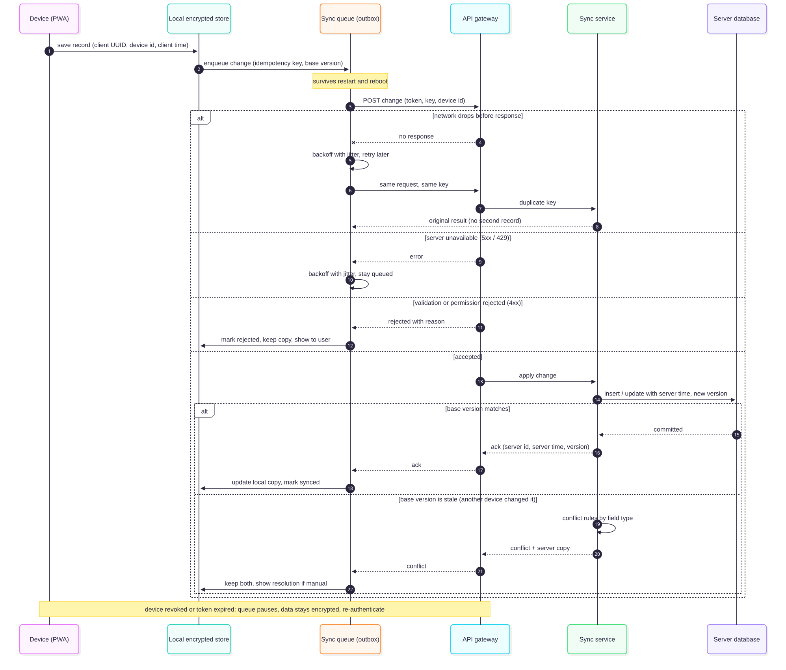

# Offline-first and synchronisation architecture (proposed)

**Status: Proposed.** The prototype's IndexedDB store, outbox and MSW mock (`apps/web/src/offline`, `apps/web/src/mock`) are **Implemented as a prototype** and covered by 26 integration tests plus browser tests. They are not production-ready. This document keeps what the prototype proved and designs what it does not cover.

## 1. What the prototype proves, and what it does not

**Proven by tests and worth keeping**

- A record and its outbox entry are written in **one transaction** (`saveAssessment`, `saveReferral`, `saveFollowUp`). A crash cannot leave a record that is not queued.
- The outbox key is `kind:clientKey`, so saving the same record twice cannot queue it twice, even on a double tap.
- **Single flight:** two sync runs at once send each item once. A call during a run triggers one more pass.
- **Dependencies:** a referral or follow-up waits for its assessment. If the parent is rejected, the child is rejected.
- **Idempotency at the server:** a repeated key returns the original with `duplicate: true`. A key that does not match the body is refused. A lost response never creates a second record.
- **Recovery after refresh:** items left `syncing` go back to `pending`.
- **Honest states:** pending, syncing, failed, rejected, synced, each visible to the CHW with the reason, and manual retry.
- **Forward-only referral merge:** pulling a referral takes the newer stage and never rolls back.
- Retry with exponential back-off, retry after a 5xx, 408, 429, network failure and `PARENT_MISSING`, no retry after a validation rejection.

**Not covered, designed below**

Encryption, device identity, authenticated requests, jitter and attempt limits, conflict detection, updates and deletions, partial and incremental pull, schema migration, app updates while offline, corrupted state, device replacement, clock skew, multi-tab safety, background sync (it runs only while the app is open, every 10 seconds), and any real device, network or second device.

## 2. Principles

1. **The device never loses a record silently.** A record leaves the device only after the server acknowledges it, and is never dropped without the user seeing it.
2. **The server is authoritative for identity, time, version, risk level and ordering.** The device is authoritative for what the CHW observed and when.
3. **Idempotent everywhere.** Any request can be repeated.
4. **Conflicts are detected, never hidden.** Where merging is safe by construction it is automatic. Otherwise it needs a human.
5. **Degrade honestly.** Every degraded state shows in the interface with what to do.

## 3. Device identity

A registered device has a `device_id` (UUID) issued by the server and a key pair created on the device (`PRODUCTION_RBAC.md` section 2). Every sync request carries the device id and is bound to it. The server records app version, last contact, last cursor and clock offset per device. A second device for the same user is allowed and expected (replacement, or a shared supervisor tablet that is not used for capture). The device id is stored in the encrypted store and is not the user's identity.

## 4. Local store

| Item           | Design                                                                                                                                                                                                                                                                                                   |
| -------------- | -------------------------------------------------------------------------------------------------------------------------------------------------------------------------------------------------------------------------------------------------------------------------------------------------------- |
| Engine         | IndexedDB through Dexie, as now                                                                                                                                                                                                                                                                          |
| Encryption     | Application-level AES-GCM of record payloads, keys per `PRIVACY_SECURITY_ARCHITECTURE.md` section 5. An authentication failure on read is treated as corruption (section 12)                                                                                                                             |
| Tables         | `records` (type, id, payload, `serverVersion`, `syncState`), `outbox` (operation, `baseVersion`, `dependsOn`, state, attempts, next attempt, last error, payload hash), `cursor` (per feed), `tombstones`, `quarantine`, `deviceMeta`, `refCache` (boundaries, facility list, codebook, active rule set) |
| Retention      | Synced records are removed after the grace period from decision D-07. Unsynced records are never removed automatically                                                                                                                                                                                   |
| Migrations     | Dexie versions with an upgrade function per step and a test that opens a database created by every released version. The prototype is at schema version 1 and has never migrated                                                                                                                         |
| Storage limits | Request persistent storage. Monitor usage and quota. At a threshold, stop new captures with a clear message rather than fail on write. **Eviction behaviour on real phones is unknown and must be tested** (section 15)                                                                                  |
| Multi-tab      | One writer per device store through a lock, so two tabs cannot run two sync loops                                                                                                                                                                                                                        |

## 5. Queue management

Operations, not only records. The prototype queues "create" of three kinds. Production queues typed operations:

| Operation                       | Who sends it                 | Notes                                          |
| ------------------------------- | ---------------------------- | ---------------------------------------------- |
| `assessment.create`             | CHW                          | Parent of everything else                      |
| `referral.create`               | CHW                          | Depends on the assessment                      |
| `referral.advance`              | Facility worker, CHW         | Appends a stage event. Depends on the referral |
| `followup.create`               | CHW                          | Depends on the assessment                      |
| `assessment.request_correction` | CHW, supervisor              | Carries `baseVersion`                          |
| `record.delete`                 | CHW (own, unsynced) or admin | Tombstone                                      |

Ordering is per dependency chain, not strict global order, so one stuck record does not block unrelated ones. The `dependsOn` mechanism from the prototype is kept. A child whose parent is `conflict`, `rejected` or `needs_attention` waits visibly.

States (prototype states in bold): **pending**, **syncing**, **failed**, **rejected**, **synced**, plus `paused_auth` (token expired or device revoked), `conflict`, `needs_attention` (automatic attempts exhausted), `quarantined` (corrupt).

## 6. Protocol

**Push:** `POST /sync/push` takes a bounded batch of operations. Each carries `deviceId`, `clientId` (the record UUID), `operation`, `baseVersion` where relevant, `occurredAt` (device clock), and the payload. The response has one result per item: `accepted` (server id, server version, `receivedAt`, the server's re-evaluated risk result), `duplicate` (original result), `conflict` (server copy), `rejected` (reasons), or `retry`. A partial success is normal and each item is acknowledged separately, which is the "partial sync" requirement.

**Pull:** `GET /sync/pull?cursor=` returns changes since an opaque server cursor for what the user may see: updated referral stages for their referrals, corrections applied, tombstones, and updated reference data and rule set versions. Paged, resumable, idempotent. The cursor is stored per feed and advanced only after the page is applied and committed.

**Idempotency:** the record UUID is the primary key and `(device_id, client_id)` is unique, so a replay can never create a second row even after idempotency records expire (`DATA_ARCHITECTURE.md` section 3).

**Acknowledgement:** the device updates its local copy with the server's values (version, time, the server's risk result) only when the acknowledgement is applied in a local transaction. If the response is lost, the next push returns `duplicate` with the same data.

## 7. Retry policy

The prototype uses 2 s doubling to 60 s with no jitter and no limit. Production:

- Exponential back-off with **full jitter**, so many phones coming online after an outage do not retry in step.
- Honour `Retry-After` on 429 and 503.
- A cap on automatic attempts per item, after which the item becomes `needs_attention` and shows in the app and to the supervisor. It is never dropped. The number is a pilot setting, not a design constant.
- Stop and wait when offline, rather than count failures. Retry at reconnection, app start, return to foreground and on a slow timer. Where the browser supports it, also use background sync, but never rely on it.
- Pause the whole queue on authentication failure (`paused_auth`), without counting it against items.

| Server answer                         | Item state                            | Why                                             |
| ------------------------------------- | ------------------------------------- | ----------------------------------------------- |
| Network error, timeout, 408, 5xx, 429 | `failed`, retry with back-off         | Transient. Prototype behaviour kept             |
| `PARENT_MISSING`                      | Wait for parent, not counted          | Prototype treats it as retryable                |
| 401                                   | `paused_auth`, queue pauses           | New in production                               |
| 403                                   | `rejected`, surfaced, queue continues | The user is not allowed. Needs an administrator |
| 400, 422                              | `rejected` with reasons               | Prototype behaviour kept. Never retried         |
| 409 version conflict                  | `conflict`                            | Section 10                                      |
| 410 or deleted                        | `conflict` (deleted upstream)         | Section 12                                      |
| 413                                   | Split the batch, retry                | New                                             |
| 426 upgrade required                  | Pause, show "update required"         | Section 12                                      |

## 8. Partial and large syncs

Batches are bounded by count and size. Photos and attachments do not exist today. If they are added they upload separately, resumably, after the record. A device returning after a long absence pulls in pages, applies each page transactionally, and can be interrupted at any point and resumed from the stored cursor. Programme-role views never sync person-level data to a device.

## 9. Client time, server time and skew

- Order and versioning use **server time and server versions**. Never the device clock.
- `occurredAt` (device clock) is kept because it is the clinical fact: when the CHW saw the person.
- At each sync the server returns its time. The device computes an offset, sends it with the next push, and the server stores `clock_offset_ms` with the record (`DATA_ARCHITECTURE.md` section 4.2).
- Timestamps far from server time, in either direction, are flagged for review rather than rejected, because phones with wrong clocks are common. Both times are shown to the supervisor. The tolerance window is a pilot setting.
- Aggregates by week use the server-corrected capture time. The prototype uses the device time as sent.

## 10. Conflict detection and resolution

A conflict means two changes to the same thing that cannot both be applied as sent. Detection uses `baseVersion`: the device states the server version it last saw, and the server compares.

**Policy by kind of data (resolves the "two devices modify the same record" question)**

| Data                                              | Can two devices change it?                                                | Rule                                                                                                                                                                                                                                        |
| ------------------------------------------------- | ------------------------------------------------------------------------- | ------------------------------------------------------------------------------------------------------------------------------------------------------------------------------------------------------------------------------------------- |
| Assessment (core facts)                           | Not normally. It is created once, on one device, and is then immutable    | A duplicate create returns the original. A **correction** is a server operation with `baseVersion`. Two corrections from stale bases: the second gets 409, nothing is overwritten, both are shown to the supervisor, who resolves manually  |
| Referral stage                                    | Yes: a facility device and the CHW's device, or two facility devices      | Stage events are **append-only**. The current stage is the **highest** stage reached (monotonic). All events are kept with actor, device and both clocks. This is the prototype's forward-only merge, made server-side                      |
| Referral stage that skips a step                  | Yes, if two devices report out of order                                   | The server accepts the later stage, records the missing earlier ones as **inferred** with a flag, and shows them as such. The prototype blocks skips. Whether inferred stages are acceptable is for the programme and clinical leads (D-10) |
| Follow-up                                         | Not on the same record. Multiple follow-ups per case are separate records | Append-only. No conflict                                                                                                                                                                                                                    |
| Soft-deleted record                               | An update arrives for a deleted record                                    | The update is **not** applied. It becomes a `conflict` showing the deleted state. Only an administrator can restore                                                                                                                         |
| Reference data, codebook, rule set, configuration | Devices never change them                                                 | **Server wins**. The device replaces its cache                                                                                                                                                                                              |
| User preferences (language, display)              | Yes                                                                       | Last write wins by server time. No clinical content                                                                                                                                                                                         |

**Never use last-write-wins for clinical content.** Anything that cannot be merged safely is stopped and shown.

**What the user sees:** a conflict banner on the record with the server's version and the device's version side by side and a clear action: keep the server's, send the device's as a correction request, or ask a supervisor. A conflict that is still open when the supervisor reviews the CHW's queue appears on the supervisor's list.

## 11. Device replacement and lost devices

1. The old device is revoked (`PRIVACY_SECURITY_ARCHITECTURE.md` section 8). Its unsynced records are at risk. If it reappears before revocation takes effect, its queue is accepted normally (idempotent).
2. The new device is registered and the CHW signs in.
3. The new device pulls what the CHW may see, in pages: their own referrals and recent assessments within the retention grace period, reference data and the rule set. It does not receive other CHWs' records.
4. Records created on the old device keep the old `device_id` for audit and are never re-attributed.
5. If a supervised recovery of the old device's unsynced queue is permitted (D-25), it happens through a one-time, logged, time-limited recovery sync from that device only.

## 12. Updates, deletions, app versions and corrupted state

| Situation                              | Design                                                                                                                                                                                                                                                                                                                                                                                                                                                                                                            |
| -------------------------------------- | ----------------------------------------------------------------------------------------------------------------------------------------------------------------------------------------------------------------------------------------------------------------------------------------------------------------------------------------------------------------------------------------------------------------------------------------------------------------------------------------------------------------- |
| **Updated record**                     | Only through the correction operation with `baseVersion` and a reason                                                                                                                                                                                                                                                                                                                                                                                                                                             |
| **Deleted record**                     | A tombstone is synced. The device removes its copy and keeps a content-free tombstone until the server acknowledges it. A delete of an unsynced record cancels its queue entry                                                                                                                                                                                                                                                                                                                                    |
| **App update while offline**           | The new version is downloaded when online and activated only when no form is open and the queue is not mid-send. Data migrates on next open. Queue entries keep the `schemaVersion` and `formVersion` they were created under, and the server accepts N-1 versions. A server that no longer accepts an old client answers 426: the app keeps all queued data, shows "update required" and syncs after updating                                                                                                    |
| **Sync after application restart**     | Items in `syncing` return to `pending` (prototype behaviour). The sync loop starts at launch                                                                                                                                                                                                                                                                                                                                                                                                                      |
| **Sync after device reboot**           | Same as restart. The encrypted store survives and the app asks for the unlock secret before any send. There is no sync while locked, which is a trade-off: background sync is not available for a locked device                                                                                                                                                                                                                                                                                                   |
| **Network interruption during upload** | The item stays `syncing` until the request fails or the app restarts, then `pending`. The retry uses the same ids, so the server answers `duplicate` or accepts. Resumable upload only matters if attachments are added                                                                                                                                                                                                                                                                                           |
| **Duplicate submissions**              | Double tap: the local transaction and unique outbox key prevent a second queue entry (tested today). Retried request: the server's unique key prevents a second row (tested today). Two devices created the "same" assessment: they are different records with different UUIDs, and a person-level duplicate check is a data-quality job (D-12), not a sync rule                                                                                                                                                  |
| **Corrupted local state**              | On open, check the schema, check each outbox payload against its stored hash, and treat any AES-GCM authentication failure as corruption. Corrupt items go to `quarantine`, are never deleted automatically, are shown to the CHW and supervisor, and synced items are re-pulled. An unrecoverable unsynced item is reported to the supervisor with its id and time, not its content. A "reset this device" action wipes the store only after confirming there are no unsynced items or after supervisor approval |
| **Out-of-date rule set offline**       | The device uses the active approved version it last downloaded. The result is a **preliminary** result shown with the version. The server re-evaluates on sync. If the levels differ the CHW and supervisor are told. A rule set past its expiry date is not used, and the app asks the user to connect (`RULE_GOVERNANCE.md`)                                                                                                                                                                                    |
| **Offline too long**                   | After the maximum offline window (policy) the app locks until it has authenticated online. Data stays encrypted                                                                                                                                                                                                                                                                                                                                                                                                   |

## 13. Offline synchronisation diagram

Source: `diagrams/c-offline-sync.mmd`. Failure, retry and conflict paths are the four branches of the central block: network loss before the response, server unavailable, rejection, and acceptance with or without a version conflict.

## 14. Observability for sync

Per device, without content: last successful sync, queue depth by state, oldest pending age, attempts distribution, conflict count, rejected count and reasons, clock offset, app version, storage usage. These feed the supervisor's "devices not synced" list and the pilot indicators (`PILOT_READINESS.md`: offline sync success, duplicate rate).

## 15. What the prototype tests today, and what must be added

| Behaviour                                | Today                   | Needed before pilot                                     |
| ---------------------------------------- | ----------------------- | ------------------------------------------------------- |
| Capture offline, sync on reconnection    | Tested (jsdom, browser) | On real phones and networks                             |
| Refresh and crash recovery               | Tested (page reload)    | Process kill, OS reboot, low memory kill                |
| Duplicates, lost response, parallel runs | Tested                  | Against the real API and database, with many devices    |
| Dependencies and rejection cascade       | Tested                  | Same                                                    |
| Back-off and recovery                    | Tested                  | With jitter and limits, and thundering-herd test        |
| Encryption, lock, wipe                   | Not present             | Unit, integration and real-device tests                 |
| Conflicts                                | Not present             | Multi-device scenarios from section 10                  |
| Migration, app update offline            | Not present             | Upgrade tests from every released version               |
| Corruption and quarantine                | Not present             | Fault injection                                         |
| Clock skew                               | Not present             | Devices with wrong clocks                               |
| Storage pressure and eviction            | Not present             | Low-storage and browser-eviction tests on target phones |
| Revocation and replacement               | Not present             | End-to-end                                              |
