# Production architecture (proposed)

**Status: Proposed.** Nothing here is built. It is a design for a pilot-ready system, shaped by the code that exists (`STAGE4_CURRENT_STATE.md`). Technology names are a **reference option** to make the design concrete. Each one is a decision for the stakeholders, listed in `STAGE4_DECISIONS.md`, and none is made silently here.

## 1. Design principles, taken from what the prototype already does

1. **Person-level and aggregate data are different systems of record.** The prototype already has two schemas and an API that never returns a person to a programme role. Production makes that a database boundary, not a convention.
2. **The server decides.** Roles, scope, risk level and referral transitions are enforced on the server. The device proposes, the server disposes.
3. **Rules are governed data.** The evaluator stays a pure function. What it evaluates is an approved, versioned rule set (`RULE_GOVERNANCE.md`).
4. **Offline is the normal case.** The queue's shape (idempotency key, dependencies, single flight, back-off) is kept and hardened (`OFFLINE_SYNC_ARCHITECTURE.md`).
5. **Start as one deployable, modular inside.** A pilot has a handful of services' worth of logic and a small team. Separate processes are added only when a measured reason exists.
6. **Synthetic and real data never share an environment.** The seed generator and the fictional geography stay for development, training and demonstration only.
7. **Fail visibly.** Every degraded state (offline, rejected, conflict, stale aggregate) is shown to the user, as the prototype already does.

## 2. System architecture

Source: `diagrams/a-system-architecture.mmd`. Red: person-level. Blue: aggregate. Yellow: governed rules. Dashed grey: future, approved integrations only.

The sketch in the Stage 4 brief (PWA, identity, API, assessment and programme services, PostgreSQL/PostGIS, aggregation, GIS, dashboard) holds. Refinements from the actual application:

- **A sync service sits beside the assessment service.** The prototype's value is in its sync semantics, so they get their own module rather than being scattered across endpoints.
- **A rules service sits between the assessment service and the database.** The server re-evaluates every assessment against the approved rule set. It does not trust the client's `riskLevel`, which the prototype's mock server does.
- **The facility worker is a first-class client.** The prototype has no facility interface (the facility step is a demo button inside the CHW app). A facility inbox of person-level referrals is a new, minimal interface on the programme web app.
- **The programme service reads only the `prog` and `ref` schemas.** It connects with a database role that has no privilege on `ops`.
- **Reports and exports are their own module** because they are where aggregate data leaves the system.

## 3. Modules and responsibilities

| Module                  | Responsibility                                                                                                                                        | Reads and writes               | Prototype it grows from                                                         |
| ----------------------- | ----------------------------------------------------------------------------------------------------------------------------------------------------- | ------------------------------ | ------------------------------------------------------------------------------- |
| API gateway             | TLS termination, authentication, coarse authorisation, schema validation, rate limiting, request ids, audit hook                                      | none                           | `mock/routing.ts` (role check, failure injection) and `api-contract`            |
| Identity and access     | Accounts, roles, scopes, device registry, sessions (`PRODUCTION_RBAC.md`)                                                                             | `iam`                          | `session/`, `DEMO_USERS`, `users` mock endpoints                                |
| Assessment and referral | Create assessments, evaluate risk, create referrals, referral stage changes, follow-ups. Enforces forward-only stages and one referral per assessment | `ops`, reads `rules`, `ref`    | `mock/handlers.ts`                                                              |
| Sync                    | Idempotent batch intake, per-item acknowledgement, conflict detection, device cursors, tombstones                                                     | `ops`, `sync`                  | `offline/sync.ts` semantics plus the idempotency handling in `mock/handlers.ts` |
| Rules                   | Serves the active approved rule set and its history. Runs the evaluator. Records which version produced which result                                  | `rules`                        | `rules-engine`                                                                  |
| Programme               | Aggregate queries, scope clamping, referral monitoring, community detail                                                                              | `prog`, `ref` only             | `mock/programmeHandlers.ts`, `packages/programme/aggregate.ts`                  |
| Aggregation jobs        | Build `prog` from `ops` on a schedule and on change, apply small-cell rules                                                                           | reads `ops`, writes `prog`     | `summarise`, `communityDetail`, `monitorReferrals`                              |
| GIS                     | Serve boundaries and facility points, join aggregates to geometry, vector tiles                                                                       | `ref`, `prog`                  | `demo-data/geography.ts`, `RiskMap.tsx`                                         |
| Reports and exports     | Generate reports from `prog`, apply classification labels, watermark, require approval for exports, log every export                                  | `prog`, `audit`                | `programme/reports.ts`                                                          |
| Notification            | Referral reminders to CHWs, overdue alerts to supervisors, rule-update notices. Channels per decision D-13                                            | `sync`, `iam` (contact points) | none                                                                            |
| Audit                   | Append-only log of security and data events, integrity chain, retention                                                                               | `audit`                        | demo `audit` table                                                              |
| Admin                   | User and device administration, configuration, reference-data releases                                                                                | `iam`, `ref`, config           | `UsersPage`, `SettingsPage`                                                     |

## 4. API boundaries

Principles: versioned (`/api/v1`), JSON, one OpenAPI document generated from the same zod schemas the client uses (the contract package becomes its source), every route names the permission it needs, every list is paged, every mutation is idempotent or explicitly not.

Mapping the prototype's 16 contract routes to production groups:

| Group                 | Prototype routes (`api-contract`)                                             | Production notes                                                                                                                                                           |
| --------------------- | ----------------------------------------------------------------------------- | -------------------------------------------------------------------------------------------------------------------------------------------------------------------------- |
| Sync (device)         | `submitAssessment`, `createReferral`, `submitFollowUp` (one record at a time) | Replace with `POST /sync/push` (a batch with per-item results) and `GET /sync/pull?cursor=` (changes since a server cursor). Keep single-record routes for the facility UI |
| Person-level (field)  | `myAssessments`, `getReferral`, `referralInbox`, `updateReferral`             | Server-side row filters: a CHW sees records from their own device or user, a facility user sees referrals addressed to their facility. Both new in production              |
| Programme (aggregate) | `programmeSummary`, `communityDetail`, `referralMonitor`                      | Same shapes, served from `prog`. Add an `asOf` timestamp so the dashboard can show how fresh each aggregate is                                                             |
| Reports               | `recordReport`                                                                | Becomes `POST /reports` (create), `GET /reports/:id` (download), and an approval step for exports (`PRODUCTION_RBAC.md`)                                                   |
| Administration        | `listUsers`, `updateUser`, `getConfig`, `updateConfig`                        | Add device management, role grants with approval, reference-data and rule-set views                                                                                        |
| Demonstration         | `resetDemo`                                                                   | **Does not exist in production.** The demo environment keeps it                                                                                                            |
| New                   | none                                                                          | `/auth/*` (through the identity provider), `/devices`, `/rules/active`, `/reference/*`, `/me`, `/health` and `/ready`                                                      |

Cross-cutting behaviour taken from the mock handlers, to be reproduced and then tested as a contract suite against the real API: idempotency key semantics, `PARENT_MISSING` retry, 409 for a duplicate referral, 409 for backward or skipped stage changes, 422 for invalid bodies, 403 for the wrong role, scope clamping and `clamped` in aggregate responses.

## 5. Database boundaries

Detailed in `DATA_ARCHITECTURE.md`. In short, one PostgreSQL cluster with PostGIS, separate schemas and separate database roles:

| Schema  | Holds                                                   | Who can connect with what privilege                                        |
| ------- | ------------------------------------------------------- | -------------------------------------------------------------------------- |
| `ops`   | Person-level operational records                        | Assessment, Sync and Rules services (read, write). Aggregation jobs (read) |
| `prog`  | Aggregates                                              | Aggregation jobs (write). Programme, GIS and Report services (read)        |
| `ref`   | Administrative units, communities, facilities, versions | Admin and the import tool (write). Everyone else (read)                    |
| `rules` | Rule sets, versions, approvals, test cases              | Rules governance tooling (write). Rules service (read)                     |
| `iam`   | Users, roles, grants, devices                           | Identity module                                                            |
| `sync`  | Device cursors, idempotency keys, tombstones            | Sync service                                                               |
| `audit` | Append-only events                                      | Every service (insert only). Auditors (read). Nobody updates or deletes    |

## 6. Background jobs

| Job                    | Trigger                                                  | Does                                                                                                                |
| ---------------------- | -------------------------------------------------------- | ------------------------------------------------------------------------------------------------------------------- |
| Aggregate refresh      | On accepted sync batch (debounced), nightly full rebuild | Recompute `prog` rows for affected communities and weeks, apply suppression, record `asOf`                          |
| Referral reminders     | Hourly                                                   | Find referrals past a configured age (the prototype's `maxUnresolvedDays` setting) and notify                       |
| Report generation      | On request                                               | Build exports asynchronously, store with expiry                                                                     |
| Retention and deletion | Daily                                                    | Apply the retention schedule (`PRIVACY_SECURITY_ARCHITECTURE.md`), record what was deleted, never what it contained |
| Reference-data import  | On approved release                                      | Validate and load new boundary and facility versions, never edit in place                                           |
| Audit integrity check  | Daily                                                    | Verify the audit hash chain and alert on gaps                                                                       |
| Backup verification    | Weekly                                                   | Restore a backup into an isolated environment and run checks                                                        |

A Postgres-backed queue is enough at pilot scale (decision D-03 and D-04 cover the technology choice).

## 7. Synchronisation service

Detailed in `OFFLINE_SYNC_ARCHITECTURE.md`. The server side: authenticated device, idempotency keys scoped to device, per-item results, server-assigned version and time, conflict detection by base version, cursors for pull, tombstones for deletion.

## 8. Notification architecture

Proposed channels, all optional and decided later (D-13): in-app badge and list (no external dependency), web push to the installed PWA, SMS, and WhatsApp or email for supervisors. Rules for every channel: no personal health detail in the message (a referral reference and a prompt to open the app), no sending without the recipient's registered contact, opt-out for non-safety messages, delivery log without message content. SMS and WhatsApp involve third parties and cost, and need privacy review.

## 9. Audit logging

An append-only `audit.event` table written in the same transaction as the action it records, with a hash chain for tamper evidence, plus export to a separate write-once store. What is logged is listed in `PRODUCTION_RBAC.md` section 7. Audit entries never contain clinical content, only who, what, which record id, which scope, when, from which device and why (a reason is mandatory for elevated access).

## 10. GIS services

Detailed in `GIS_PRODUCTION_ARCHITECTURE.md`. The programme dashboard asks the GIS module for geometry (by level and version) and the programme module for numbers, and joins them in the browser by stable ids, as the prototype does with community ids today. Vector tiles (generated from PostGIS) are added when the geometry becomes too large to send as GeoJSON.

## 11. Reporting and export service

Exports are where data leaves the controlled system, so they get controls the prototype only gestures at: report definitions from `packages/programme/reports.ts`, small-cell suppression applied before building, a visible data classification on every file (replacing the "SYNTHETIC DEMONSTRATION DATA" notice with the real classification, and keeping that notice for the demo environment), a watermark with the requester and time, approval for exports above a defined sensitivity, expiry of download links, and an audit event per export. Person-level exports do not exist for programme roles.

## 12. Monitoring and observability

- **Metrics:** request rate, error rate and latency per route, sync batch size and failure rate per device cohort, queue depth, aggregation lag, job failures, database health. The pilot indicators in `PILOT_READINESS.md` come from the same data.
- **Logs:** structured, with a request id, **no personal health information, no tokens, no full request bodies**. Log redaction is tested.
- **Alerts:** availability, error budget, stuck sync, audit gaps, failed backups, certificate and secret expiry, unusual access (`PRIVACY_SECURITY_ARCHITECTURE.md`).
- **Client telemetry:** app version, sync outcomes and storage errors only, opt-in per policy, no content.

## 13. Hosting and deployment shape

Not chosen. See D-01 and D-23 in `STAGE4_DECISIONS.md`. Whatever is chosen should provide: data residency that satisfies the legal review, encryption at rest with customer-managed keys, private networking for the database, separate environments (development with synthetic data only, staging with synthetic data, pilot with real data), infrastructure as code, and a restore procedure that has been exercised. A modular single deployable behind a managed PostgreSQL with PostGIS is the smallest shape that meets this.

## 14. Reference technology (assumption pending approval)

| Concern          | Reference option                            | Why it fits this code base                                                                                                                                             | Main alternatives                                                                  |
| ---------------- | ------------------------------------------- | ---------------------------------------------------------------------------------------------------------------------------------------------------------------------- | ---------------------------------------------------------------------------------- |
| Backend language | TypeScript on Node                          | `domain`, `rules-engine` and `programme` are pure TypeScript with zod. They run server-side unchanged, so there is one definition of validation, rules and aggregation | Python (strong GIS and data tooling), Java or Kotlin (common in DHIS2 shops), .NET |
| API style        | REST with OpenAPI                           | The contract package already describes REST routes and permissions                                                                                                     | GraphQL (not needed)                                                               |
| Database         | PostgreSQL with PostGIS                     | Named in the brief. Native spatial types, row-level security, mature backups                                                                                           | A managed cloud equivalent                                                         |
| Identity         | OpenID Connect provider with MFA            | Standard, avoids storing passwords, supports device-bound sessions                                                                                                     | Self-hosted Keycloak, national or ministry SSO, a managed identity service         |
| Jobs             | Postgres-backed queue                       | One less system to run                                                                                                                                                 | A message broker                                                                   |
| Client           | Installable PWA on the existing React app   | The UI is built and tested. A wrapper app (Capacitor) can be added if the PWA's storage or notification limits bite on target phones                                   | Native Android app                                                                 |
| Local storage    | IndexedDB with application-level encryption | Keeps Dexie and the tested queue                                                                                                                                       | SQLite WASM with encryption                                                        |

The one real risk in the reference option is the PWA. Storage limits, eviction policy, background sync and push behave differently across Android browsers and versions, and the prototype has never run on a real phone. The pilot readiness gate includes a real-device test before this choice is locked.

## 15. Non-functional targets

No targets are set here. Availability, latency, recovery time and recovery point objectives, supported devices and maximum offline duration must come from the pilot design and the stakeholders. Where `PILOT_READINESS.md` suggests a number it is labelled as a proposed pilot target.

## 16. Mapping to delivery phases

See `STAGE4_REPORT.md` section 14 for the recommended phases. In summary: foundations (identity, database, contract tests, audit), then the field loop (assessment, sync, referral, facility inbox), then programme intelligence on real aggregates, then GIS with verified data, then interoperability, each gated by the readiness criteria.
