# Rules engine governance (proposed)

**Status: Proposed.** The demonstration rule set stays demonstration-only. Nothing in Stage 4 validates, approves or activates any rule. This document defines how a rule could ever become clinically active, so that it cannot happen by accident, by a developer's edit, or by an administrator's permission.

> No rule becomes clinically active because a developer changes a file. A rule is active only when a recorded, independent, multi-person approval exists in the governance system, the content matches what was approved, and the effective date has arrived.

## 1. What exists today

From `packages/rules-engine` (`STAGE4_CURRENT_STATE.md` section 5):

- One rule set, `demo-placeholder` version `0.1.0`, status `DEMO_PLACEHOLDER`, ten rules (1 URGENT, 6 HIGH, 3 MODERATE). The ids, thresholds and wording are arbitrary placeholders. They are not derived from, and must not be compared with, any protocol.
- The schema (`schema.ts`) is strict. Rule and action text may not diagnose, prescribe or name treatments. A demo rule set id must start with `demo-`. Duplicate rule ids are rejected.
- **A gate that exists but is weak:** a rule set with status `VALIDATED` must carry a `review` block with at least two reviewer names and an approval date. This is text in the same file a developer edits. It proves nothing about who reviewed, when, what, or whether the content later changed.
- Unknown or missing answers yield no level, or a warning that the result may understate concern. The evaluator is deterministic and has 35 tests. `docs/RULES.md` is tested against the data.
- The rule set is bundled into the client and evaluated on the device. The mock server trusts the result.
- The `admin` role holds a `rules:manage` permission name. The interface only shows rule information, but the permission as named would allow changes. It is removed in production (`PRODUCTION_RBAC.md` section 9).

## 2. Governance model

```text
Rule proposal
     |
Clinical and public-health review
     |
Technical validation
     |
Second independent review
     |
Approval
     |
Version release
     |
Monitoring
     |
Periodic review
```



Source: `diagrams/d-rule-lifecycle.mmd`. Every arrow back to Proposed is a normal outcome, not a failure.

### 2.1 Stages and who does what

| Stage                                | What happens                                                                                                                                                                                     | Who (functions, not names)                                          | Output                                       |
| ------------------------------------ | ------------------------------------------------------------------------------------------------------------------------------------------------------------------------------------------------ | ------------------------------------------------------------------- | -------------------------------------------- |
| 1. Rule proposal                     | A change is drafted with its purpose, intended population and setting, the evidence it rests on, and the expected effect on referral volume                                                      | Rule Author (programme, clinical or public-health staff)            | Proposal record and a draft rule set version |
| 2. Clinical and public-health review | Experts assess the content against the evidence and the national programme guidance, the wording, the thresholds, the fail-safe behaviour for missing data, and the population it applies to     | Clinical Reviewer, Public-Health Reviewer (NTD expertise, per D-10) | Written review, decision, requested changes  |
| 3. Technical validation              | The engineering team proves the version behaves as specified: schema valid, forbidden-wording check, every test case passes, comparison with the previous version, determinism                   | Technical Validator (not the Author)                                | Validation report with the test results      |
| 4. Second independent review         | A reviewer **independent** of the author and of the first reviewers (different function, preferably a different organisation) examines the evidence, the first review, and the validation report | Independent Reviewer                                                | Written second review                        |
| 5. Approval                          | The Rule Approval Board records its decision with the effective date, the review date and the scope (geography, population)                                                                      | Rule Approval Board (quorum rules per D-10)                         | Signed approval record                       |
| 6. Version release                   | The approved, content-hashed version is published as immutable and scheduled for its effective date, to the pilot geography first. Devices download it. CHWs are trained and told what changed   | Release manager (cannot approve), programme training lead           | Release record, training record              |
| 7. Monitoring                        | Defined indicators are watched from the first day (section 6)                                                                                                                                    | Programme monitoring lead, clinical lead                            | Monitoring reports                           |
| 8. Periodic review                   | At or before the review date the Board re-affirms, changes or retires the version                                                                                                                | Rule Approval Board                                                 | Re-affirmation or a new proposal             |

### 2.2 Independence and conflicts

- The author never reviews or approves their own proposal.
- Reviewer 1, reviewer 2 and the approver sets do not overlap. At least one reviewer is independent of the programme implementer.
- Every reviewer records a conflict-of-interest declaration for the version.
- Quorum and the composition of the Board are decision D-10. No reviewer is named in this document.
- Application administrators, including the Super Administrator, are **not** reviewers or approvers by virtue of that role.

## 3. What a rule set version records

The existing schema has `id`, `version`, `status`, `description`, `actions`, `rules` and an optional `review`. Production adds the following. Each row says what the Stage 4 brief asked for.

| Field                        | Purpose                                                                                                                                                 | Exists today                                 |
| ---------------------------- | ------------------------------------------------------------------------------------------------------------------------------------------------------- | -------------------------------------------- |
| `rule_set_id`, `version`     | Identity. Semantic version, immutable once approved                                                                                                     | Yes                                          |
| `content_hash`               | Hash of the canonical rule content. Approval is bound to it. A changed byte means a different version                                                   | No                                           |
| `status`                     | `DEMO_PLACEHOLDER`, `DRAFT`, `IN_REVIEW`, `APPROVED`, `ACTIVE`, `SUSPENDED`, `RETIRED`. Only `ACTIVE` is served in the pilot environment                | Two values (`DEMO_PLACEHOLDER`, `VALIDATED`) |
| `author`                     | Person and function                                                                                                                                     | No                                           |
| `reviewers[]`                | Each with role (clinical, public-health, technical, independent), organisation, review date, decision, link to the written review, conflict declaration | Names only (at least two)                    |
| `approval`                   | Board decision, approvers, date, scope, signed by each approver's account with strong authentication                                                    | A date only                                  |
| `evidence[]`                 | Citations or documents each rule rests on, with the rule ids they support. The reviewers supply these. None are invented here                           | No                                           |
| `intended_use`               | Population, setting, user (CHW), purpose (screening prompt and referral), and explicit exclusions                                                       | No                                           |
| `effective_from`             | Date and time the version becomes active                                                                                                                | No                                           |
| `review_by` and `expires_on` | Mandatory review date and a hard expiry                                                                                                                 | No                                           |
| `scope`                      | Geography (pilot LGAs) and population the version applies to                                                                                            | No                                           |
| `change_history[]`           | For each version: what changed, why, the diff of rules and thresholds, the proposer, the proposal id                                                    | No (git history only)                        |
| `supersedes`, `rollback_to`  | The previous approved version and the version to restore                                                                                                | No                                           |
| `test_cases`                 | Link to the fixed test case set with expected results (section 4)                                                                                       | Unit tests in the repository                 |
| `validation_status`          | Technical validation result, date, commit, tool versions, pass counts. Plus clinical validation status as a separate field with its own evidence        | No                                           |
| `known_limitations`          | What the rules do not cover, shown to users and reviewers                                                                                               | Partly in `RULES.md`                         |
| `monitoring_plan`            | Indicators and review triggers for this version (section 6)                                                                                             | No                                           |
| `translations[]`             | Reviewed display text per language, each with its own review record                                                                                     | English only                                 |

**Clinical validation is not technical validation.** Passing the test suite shows the software does what the rules say. It says nothing about whether the rules are right. The two statuses are recorded separately and the interface shows the clinical one.

## 4. Test cases

A fixed, versioned case set kept in the governance system, separate from the unit tests a developer can edit.

- Every rule has cases that make it fire and cases that make it not fire, including each threshold boundary (the prototype already tests boundaries).
- Cases for missing and unknown answers, conflicting indicators, the maximum and minimum inputs, and combinations that interact.
- Each case has an **expected level and expected reasons, written by the clinical reviewer**, not generated from the current output. A test that only repeats what the code does proves nothing.
- A comparison report between versions: which cases change level and why, and the level distribution on an agreed reference set. Reviewers sign off each change in distribution.
- Cases are synthetic or de-identified and approved for use. **No real patient data is used to tune rules during validation** unless the data approvals, ethics and privacy reviews allow it.

## 5. Release and distribution

- A version is released as a signed bundle. The rules service verifies the signature and the approval record before serving it, and refuses any version without both.
- `effective_from` and `expires_on` are enforced by the server and by the device's cached copy.
- Pilot rollout by geography, with the previous version retained until the new one is confirmed.
- Every assessment stores the rule set id, version and content hash that produced its result (`ops.risk_result`, `DATA_ARCHITECTURE.md`). The server re-evaluates on sync, so the result of record is the server's, under a named version.
- **Fail-safe when no valid version exists** (not approved, expired or suspended): the app still lets the CHW record the assessment, shows no risk level, and shows the instruction approved by the programme for this case (for example "follow national guidance and refer if concerned"). It never shows a stale or demonstration result as if it were valid. The exact wording and behaviour is decision D-10.
- Separation of environments: the pilot and production environments refuse to load any rule set whose id starts with `demo-`. The demonstration environment refuses to load anything else. A build check fails if a file in the repository claims to be `ACTIVE`.

## 6. Monitoring

Indicators are defined in the version's monitoring plan and reviewed on a schedule the Board sets. Candidates:

- Distribution of levels by community and over time, and drift after a release.
- Rate of unclassified results (missing data) and which questions are left unknown most often.
- Device and server mismatch rate (different level computed).
- CHW feedback and reported disagreement with the result, through a simple in-app report.
- Referral outcomes recorded by facilities, as a signal that levels are or are not useful. These outcomes are **not** treated as proof of accuracy without a designed evaluation.
- Safety reports from any user, with a clear route and a response time.
- Equity checks across age groups, sexes and geographies.

A monitoring trigger does not change a rule automatically. It opens a review.

## 7. Periodic review, suspension and rollback

- Every version has a mandatory review date. Reaching `expires_on` without re-affirmation deactivates the version, and the fail-safe in section 5 applies.
- **Emergency suspension:** any Clinical Reviewer or the safety lead can suspend a rule or a rule set on a safety signal. Suspension takes effect at once for new assessments and devices pick it up at next contact. Resumption requires the Board.
- **Rollback:** restore the previous approved version through an expedited path with two approvers and an immediate notice to all CHWs and supervisors. The record shows who, when and why. Assessments keep the version they were evaluated under. History is never rewritten. Re-evaluating historical records under a new version is allowed only as a clearly labelled analysis.
- **Retirement:** a superseded version is retained, immutable, for audit and reproducibility.

## 8. Controls that make a file edit insufficient

1. The rules service reads only the `rules` schema. It does not read rule files from the application code.
2. Activation writes an approval record signed by several authenticated people. The service checks the signatures, the content hash and the date window on each load.
3. The `rules` schema is writable only by the governance tool role, which only the Board's workflow can invoke. Developers and administrators have no write grant.
4. A repository check rejects any rule set file claiming a status beyond `DRAFT`, and any `ACTIVE` file at all.
5. Every attempt to read, propose, approve, activate, suspend or roll back is an audit event.

## 9. Interaction with the Stage 3 code

The change is small and additive. Keep `evaluate`, the schema checks, the forbidden-wording check and the demo rule set. Extend `ruleSetSchema` with the metadata above and the new status values. Move the "VALIDATED needs two reviewers" check to a function that verifies a signed approval record rather than trusting a block of text. Keep the doc-versus-data test pattern and generate the human-readable rule document from each approved version.

## 10. What this document does not do

It does not name reviewers, choose a validation method, decide any threshold, or claim any rule is valid. It does not decide whether the product falls under medical-device or clinical decision support regulation, which is a legal and regulatory question (`PRIVACY_SECURITY_ARCHITECTURE.md` question 15). Decision D-10 covers who the reviewers are and how the Board works.
