# Stage 4: current-state assessment

What Stages 1 to 3 actually built, what in it can carry forward, and what cannot. Everything below was checked against the code in this repository, not against the original specification.

**Status words used in all Stage 4 documents**

| Word                      | Meaning                                                                                  |
| ------------------------- | ---------------------------------------------------------------------------------------- |
| **Implemented**           | Exists in this repository and is covered by tests, as a prototype against synthetic data |
| **Simulated**             | Exists only to demonstrate behaviour. It protects nothing                                |
| **Proposed**              | A design for later. Nothing is built, and it needs approval (see `STAGE4_DECISIONS.md`)  |
| **Requires legal review** | A legal, privacy, ethics or clinical question that engineers cannot settle               |

**Scope of the prototype:** every record, place, facility, person and number is synthetic. The risk rules are placeholders and are not clinically validated. No real data, backend, authentication, integration or deployment exists.

## 1. Size and shape

- About 13,400 lines of TypeScript and TSX, including tests. React 19, Vite 8, TypeScript strict (`noUncheckedIndexedAccess`), npm workspaces consumed as source (no per-package build).
- 236 unit and integration tests in 17 files, and 36 browser tests (18 specs on a mobile and a desktop profile) including axe accessibility scans. `npm run check` runs typecheck, lint, format check, tests and build.
- Production build: main chunk about 368 kB (116 kB gzip). The MapLibre chunk is about 1.06 MB (287 kB gzip) and loads only on the GIS page. CHW screens and each programme page are separate lazy chunks.

## 2. Frontend architecture

| Part                | What exists                                                                                                                                                                                                            |
| ------------------- | ---------------------------------------------------------------------------------------------------------------------------------------------------------------------------------------------------------------------- |
| Routing             | React Router with a `lazy` loader per route (`apps/web/src/routes.tsx`). Two areas: `/chw/*` and `/programme/*`. Route guards `RequireArea` and `RequirePage` read the simulated role                                  |
| State               | TanStack Query for server data (`['programme', ...]` keys), Zustand for the assessment draft (`sessionStorage`), the demo session (`sessionStorage`), the programme filters (memory) and the mock controls             |
| Local records       | Dexie over IndexedDB (`ntd-watch-local`)                                                                                                                                                                               |
| UI                  | `packages/design-system` (tokens, light and dark, form components, notices). CSS Modules. Risk is always symbol plus text. English only through `react-i18next`, with a test that fails if a key is missing            |
| CHW app             | 16 screens in `apps/web/src/chw/screens`: sign-in, dashboard, new assessment (start, person, symptoms, context, WASH, summary), result, referral new, referral status, referral list, follow-up form and list, profile |
| Programme dashboard | 9 pages in `apps/web/src/programme/pages` on a shared filter store, hand-built SVG and HTML charts with data-table alternatives                                                                                        |
| PWA                 | **Not implemented.** There is no web manifest and no application service worker. The only service worker is the mock API (`mockServiceWorker.js`)                                                                      |

## 3. Package structure

| Package                  | Purpose                                                                                                                      | Depends on               |
| ------------------------ | ---------------------------------------------------------------------------------------------------------------------------- | ------------------------ |
| `packages/domain`        | Roles, permissions, risk levels, referral pathway, zod entity schemas, data scope, safety notices                            | zod                      |
| `packages/rules-engine`  | Rule set schema, validator, evaluator, the demonstration rule set                                                            | domain                   |
| `packages/programme`     | Aggregation (`summarise`, `communityDetail`, `monitorReferrals`), synthetic seed, consistency check, report and CSV builders | domain, demo-data, rules |
| `packages/api-contract`  | Route table with the permissions each route needs, and header names                                                          | domain                   |
| `packages/demo-data`     | Fictional states, LGAs, wards, communities, facilities, CHWs, users, generated GeoJSON                                       | domain                   |
| `packages/design-system` | Tokens, base CSS, accessible components                                                                                      | none                     |
| `apps/web`               | The application, the offline layer and the mock API                                                                          | all of the above         |

The boundary between the domain packages and the application is clean: the domain, rules and programme packages contain no React, no browser APIs and no IndexedDB. That is why they can move to a server.

## 4. Domain model

Defined in `packages/domain/src/entities.ts` as strict zod objects with `demo: true`.

- **Assessment** (person-level): `id` (short code), `clientKey` (idempotency key, at least 8 characters), `chwId`, `communityId`, `capturedAt`, `ageGroup` (four bands), `sex`, `symptoms` (code array), `duration`, `progression`, `exposure` (four tri-state answers), `wash` (four observations), `riskLevel`, `riskWhy`, `ruleSetId`, `ruleSetVersion`. No name, phone, address, national id or free text. A test rejects those fields.
- **Referral**: `id` (`NTDW-YYYY-<uuid>`, legacy six-digit still valid), `assessmentKey`, `facilityId`, `riskLevel`, `stage`, `stageTimestamps` (one per stage reached).
- **FollowUp**: `clientKey`, `assessmentKey`, `referralId`, `performedAt`, `personReached`, `attendedFacility`, `condition`, `needsFurtherReferral`.
- **Referral pathway**: GENERATED, ACCEPTED, PATIENT_ARRIVED, ASSESSED, FOLLOW_UP, CLOSED. Forward only, one stage at a time (enforced by the mock server). "Unresolved" means not assessed within a configurable number of days (default 7).
- **CommunityAggregate** is the aggregate schema with no person fields.

What the model does **not** have, and production will need (details in `DATA_ARCHITECTURE.md`):

- No record version, `updatedAt`, `serverReceivedAt`, `deletedAt` or `createdBy` user id. Records are write-once.
- No device id, and no consent or notice field.
- No person identity of any kind. Follow-up is tied to an assessment, not to a person. That is a privacy strength and a clinical-workflow question (decision D-12).
- No actor on a referral stage change, and no facility user identity.
- No time-zone or locale handling beyond ISO UTC strings.
- Identifiers are chosen by the client (`clientKey`, `id`, referral id derived from the key). A server must issue or validate them.

## 5. Rules engine

`packages/rules-engine`. Rules are data, evaluated by a pure function.

- 10 enabled rules in one rule set (`demo-placeholder`, version `0.1.0`, status `DEMO_PLACEHOLDER`): 1 URGENT, 6 HIGH, 3 MODERATE. Seven derived facts (`symptoms`, `symptomCount`, `durationRank`, `progression`, `exposureCount`, `householdSimilar`, `washRiskCount`) and six operators.
- The schema forbids diagnostic, prescriptive and treatment wording in rules and actions. It requires a demo rule set id to start with `demo-`.
- **An existing gate:** status `VALIDATED` is accepted only with a `review` block of at least two reviewer names and an approval date.
- Missing or unknown answers lead to a null level or a warning that the result may understate concern, never to a silent LOW. `docs/RULES.md` is checked against the rule data by a test.

Gaps that matter for governance:

- The "review" block is self-asserted text in the same file a developer edits. Nothing stops a developer from writing two names and a date. There is no approval record, no evidence reference, no effective or expiry date, no change history and no rollback.
- The rule set is bundled into the client and evaluated **on the device**. The mock server stores whatever `riskLevel` the device sends and never re-evaluates. In production the server must not trust a client-computed level for programme intelligence.
- The `admin` role holds a `rules:manage` permission. The interface offers read-only rule information, but the permission as named would let an administrator change rules, which the governance design forbids (see `RULE_GOVERNANCE.md`).

## 6. Mock API

`apps/web/src/mock`. MSW handlers (service worker in the browser, Node server in tests) backed by a second IndexedDB database (`ntd-watch-mock-server`, tables for assessments, referrals, follow-ups, meta, users, audit).

- Routes implemented: 14 of the 16 in `packages/api-contract`. Not implemented: `myAssessments` and `referralInbox` (the facility's person-level inbox). Both stay in the contract as the integration seam.
- Behaviour worth keeping as a specification: idempotency through `Idempotency-Key` (a repeat returns the original with `duplicate: true`, a key that does not match the body is rejected), `PARENT_MISSING` when a child arrives before its parent, one referral per assessment (409 `REFERRAL_EXISTS`), forward-only stages, scope clamping, aggregate-only programme endpoints, 403 for the wrong role.
- Failure injection (server down, fail the next N, drop the next response, latency) for demonstration and tests.
- **Simulated security:** the role comes from a client-supplied `X-Demo-Role` header and the scope from `X-Demo-Scope`. Anyone can change either. The server also trusts `chwId` in the body.
- The facility step is demonstrated by a "simulate facility update" button in the CHW app. There is **no facility user interface** and no person-level referral inbox.

## 7. IndexedDB and the offline queue

`apps/web/src/offline`. Prototype functionality, covered by 26 tests plus browser tests.

- Device store: tables `assessments`, `referrals`, `followUps`, `outbox` (schema version 1, no migrations yet).
- Outbox item: key `kind:clientKey` (a duplicate save cannot queue twice), `dependsOn`, `status` (pending, syncing, failed, rejected, synced), `attempts`, `lastError`, `nextAttemptAt`.
- Sync loop: single-flight with a re-run flag, oldest first, parent before child, retry with exponential back-off from 2 s doubling to 60 s (no jitter and no attempt limit), `recoverInterrupted` after a refresh, manual "Sync now" and "Retry". Retryable: network error, 5xx, 408, 429, `PARENT_MISSING`. Rejected: other 4xx.
- Triggers: on app start, on reconnection, every 10 seconds, and after each save. **Sync runs only while the CHW app is open.**

Not covered: encryption of local data, device identity, authenticated sync, conflict detection (records are write-once), updates and deletions, partial or paged sync, schema migration, storage quota or eviction, multi-tab coordination, a second device, background sync, data retention on the device, and clearing the store on sign-out.

## 8. Programme aggregation

`packages/programme/src/aggregate.ts` (584 lines). Pure functions over person-level records.

- The mock server loads seed plus live records, **clamps the requested filters to the caller's scope**, and aggregates on the fly. Programme pages never receive a person-level record, and tests assert that no response contains a client key, referral id or age and sex fields.
- Definitions that are already specified and tested: signal (HIGH or URGENT assessment, not a case), vulnerability index (mean of four WASH indicator rates, at least 5 assessments and 3 known indicators), demonstration bands (30 and 45), direction (last 28 days against the 28 before), referral completion, unresolved, weekly buckets starting Monday UTC, previous period of equal length. The overview hides a percentage change when the previous period holds less than half as much data.
- Aggregation runs per request over all records. That is fine for 650 synthetic assessments and will not scale. Production should compute these in background jobs into an aggregate store, keeping these functions as the tested definition.
- **No small-cell suppression.** With 15 communities a count of 1 or 2 is common and could identify a person in a small community.

## 9. GIS architecture

- `packages/demo-data/src/geography.ts` generates fictional GeoJSON from a jittered lattice near coordinates (0, 0): community polygons, facility points, and ward, LGA and state boundaries as shared-edge lines. Not a real place and labelled so.
- `RiskMap.tsx` uses MapLibre GL JS 6.14 with **no basemap, no tiles and no glyphs**. Layers: community fill (vulnerability), community outline, ward, LGA and state lines, selected outline, facility points. Community names and signal counts are DOM markers, so they are real, keyboard-reachable buttons. WebGL is required; a table is the fallback.
- Two independent layers are shown (demonstration risk signals, and WASH and environment vulnerability) plus facilities. Selecting a community opens an aggregate-only panel.
- No coordinate reference system is declared (the data is plain lon/lat numbers), no boundary versioning, no spatial queries, and no spatial database.
- The map assumes **one polygon per community**. Real community boundaries are not a standard national dataset (see `GIS_PRODUCTION_ARCHITECTURE.md`).

## 10. Authentication and session simulation

`apps/web/src/session/demoSession.ts`. A Zustand store holds a role in `sessionStorage`. The landing page and sign-in screen set it. The sign-in screen accepts any four digits and checks nothing. There are no tokens, no accounts, no passwords and no expiry. Everything about it is labelled simulated in the interface.

## 11. RBAC model

`packages/domain/src/roles.ts`. Five roles (`chw`, `facility`, `lga`, `state`, `admin`), 14 permissions, page access per role, and a list of person-level permissions that no programme role may hold (tested). The data scope per role (`all`, `state`, `lga`, `facility`) is in `packages/domain/src/scope.ts`.

- **Strength:** the permission names, the person-level versus aggregate split and the scope kinds are a sound starting vocabulary. The Super Administrator holds programme intelligence, users, settings and rules information but no person-level permission.
- **Gaps:** enforcement is in the browser and in a mock that trusts headers. There is no supervisor, no project administrator, no rule reviewer, no purpose or approval concept, no break-glass access, and no per-record (row-level) rule such as "a facility sees only referrals sent to it" beyond the aggregate monitor.

## 12. Audit model

`serverDb.audit` records only three actions: `report.generated`, `user.updated` and `config.updated`, each with time, actor, action, target and detail. It lives in the same IndexedDB as the data, is editable, and records nothing for reads, exports, sign-ins, permission denials or person-level access (there is no person-level access path from a programme role). It is a demonstration of the idea, not an audit trail.

## 13. Synthetic data model

- Hierarchy: 2 states, 5 LGAs, 10 wards, 15 communities, 9 facilities, 11 CHWs, all named "Demo". CHW-0142 is the live demo account and is not seeded.
- `generateSeed` (deterministic, seed 20261018, 12 weeks) produces about 650 assessments, 75 referrals and 42 follow-ups. Risk levels come from the real demo rules engine. Hidden community profiles (WASH, signal, volume, trend) only drive the generator. Three communities rise, five have no CHW. `checkConsistency` verifies referential and temporal soundness.
- Live records from the CHW app are added to the seed when they sync to the mock server.
- Limitation: synthetic patterns say nothing about real epidemiology and must never appear in a funder or partner claim.

## 14. Testing architecture

| Layer                               | Tools and scope                                                                                                                         | Count        |
| ----------------------------------- | --------------------------------------------------------------------------------------------------------------------------------------- | ------------ |
| Unit                                | Vitest: domain 31, rules 35, programme 38, demo-data 14, contract 3, design system 15, i18n 4, navigation 3                             | 143          |
| Integration (jsdom, fake-indexeddb) | Offline sync 26, mock API 20, CHW workflow 10, app shell 9, programme pages and map (mocked MapLibre) 28                                | 93           |
| End to end                          | Playwright on Chromium, mobile and desktop, against the production build with the mock API in a service worker. Real WebGL map rendered | 36           |
| Accessibility                       | axe (WCAG 2.0 and 2.1 A and AA tags) on landing, sign-in, every CHW screen and every programme page. ESLint `jsx-a11y`                  | in the above |

Only the unit and integration layers and the browser flows are automated. There is no continuous integration (no `.github` directory), no coverage report, no load or performance test, no security test, no real-device test and no manual screen-reader test. The first run on the project owner's slower Windows machine failed on timeouts, not defects, so the tests had been tuned on a fast machine. Timeouts were raised afterwards. Performance and slow-device behaviour of the application itself has not been measured.

## 15. Current limitations

1. Nothing is secure. Roles, scope, sign-in and audit are simulated.
2. The server is a browser database. No multi-user, multi-device or durable store exists.
3. Local data is unencrypted and never expires.
4. The rule set is client-side and the server trusts the result.
5. No small-cell suppression, no data-protection design, no consent model.
6. Fictional geography only. Real boundaries and facility data have never been loaded.
7. Not a PWA. Not tested on real phones, real networks or real storage limits.
8. Programme views update only after a CHW record has synced.

## 16. What can move toward production, and what cannot

Diagram: `diagrams/e-prototype-to-production.svg`.

| Component                                         | Disposition                    | Reason and work needed                                                                                                                                                                                                                            |
| ------------------------------------------------- | ------------------------------ | ------------------------------------------------------------------------------------------------------------------------------------------------------------------------------------------------------------------------------------------------- |
| `domain` schemas, referral pathway, risk levels   | **Carry forward**              | Pure TypeScript. Reuse on server and client as the shared validation library. Add versioning, audit and identity fields (`DATA_ARCHITECTURE.md`)                                                                                                  |
| `domain` roles and permissions                    | **Strengthen**                 | Keep the vocabulary. Add roles (supervisor, project administrator, reviewer), purposes, approvals. Enforce on the server                                                                                                                          |
| `rules-engine` evaluator and schema               | **Carry forward, then wrap**   | The evaluator is deterministic and tested. Move it behind a rules service that serves only approved versions, and replace the self-asserted review block with real approval records (`RULE_GOVERNANCE.md`)                                        |
| Demonstration rule set                            | **Keep as demo only**          | Never promote it. A validated rule set is a new artefact from a governed process                                                                                                                                                                  |
| `programme` aggregation functions                 | **Carry forward as the spec**  | Keep as the tested definition. Run them in background jobs over the database. Add small-cell suppression and parity tests against the database implementation                                                                                     |
| `programme` seed, `demo-data` geography and users | **Keep for demo and tests**    | Retain for development, training and demonstration, in an environment that can never hold real data. Never mix with real data                                                                                                                     |
| `programme` reports and CSV builder               | **Strengthen**                 | Keep the synthetic labelling pattern, add real-data classification labels, export approval, watermarking and an export audit trail                                                                                                                |
| `api-contract`                                    | **Strengthen**                 | Becomes an OpenAPI description generated from the same schemas. Keep the permission-per-route idea                                                                                                                                                |
| Design system, i18n, page structure, charts       | **Carry forward**              | Tested, accessible and independent of the backend. Add language packs after review. Re-check contrast on real devices                                                                                                                             |
| CHW screens and programme pages                   | **Carry forward, rewire**      | Replace the mock transport. Add the facility interface, supervisor views and admin consoles                                                                                                                                                       |
| `offline` sync loop and outbox                    | **Strengthen**                 | The queue semantics (idempotency, dependencies, back-off, single flight) are the right shape. Add device identity, encryption, authenticated requests, jitter, limits, conflict handling, updates and migrations (`OFFLINE_SYNC_ARCHITECTURE.md`) |
| `mock` handlers and `serverDb`                    | **Replace**                    | Keep the handlers' behaviour as an executable specification for contract tests against the real API                                                                                                                                               |
| `session` demo role and PIN                       | **Replace**                    | With an identity provider, server-side sessions and tokens                                                                                                                                                                                        |
| Demo audit table                                  | **Replace**                    | With an append-only server audit log                                                                                                                                                                                                              |
| Fictional GeoJSON generator                       | **Replace for production use** | With verified, versioned reference data in PostGIS. Keep the generator for tests                                                                                                                                                                  |
| MapLibre map component                            | **Carry forward, rewire**      | Keep MapLibre. Feed it vector tiles or server GeoJSON for verified geography, and add a basemap only after a licence and privacy decision                                                                                                         |
